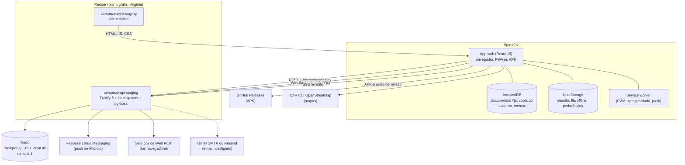

# Arquitetura do Compoze

Como as peças se juntam, do aparelho ao banco. Os detalhes de cada lado estão
em [frontend/arquitetura.md](frontend/arquitetura.md),
[backend/desenvolvimento.md](backend/desenvolvimento.md) e
[backend/contrato-da-api.md](backend/contrato-da-api.md); o porquê de cada
escolha, nos [ADRs](decisoes/README.md).

## Visão de cima

## As peças

| Peça | O que é | Onde está |
| --- | --- | --- |
| `apps/web` | O app: React 19, Vite 7, Tailwind CSS 4, Zustand, React Query, React Router 7. É o mesmo código no navegador, na PWA e no APK | [frontend/arquitetura.md](frontend/arquitetura.md) |
| `apps/web/android` | Projeto Android do Capacitor 8 que empacota o `apps/web` | [mobile/android.md](mobile/android.md) |
| `apps/api` | A API: Fastify 5, Zod, Drizzle. Dentro dela rodam também o Hocuspocus (edição em tempo real), o fluxo ao vivo (SSE), o envio de push e os jobs do pg-boss | [backend/desenvolvimento.md](backend/desenvolvimento.md) |
| `packages/contracts` | Schemas Zod do contrato da API. A API valida com eles, o banco cria os enums a partir deles e o front tira deles os tipos | `packages/contracts/src` |
| `packages/db` | Schema Drizzle (uma tabela por arquivo), migrações SQL numeradas e a conexão | `packages/db` |
| `packages/documento` | O formato do documento Yjs de uma canção, usado pelo front e pela API | [ADR 0007](decisoes/0007-documento-yjs-da-cancao.md) |
| PostgreSQL 18 | Único banco. Guarda tudo, inclusive áudio e imagens (`bytea`), a fila de jobs e as chaves de push | Neon |

Monorepo com pnpm e Turborepo ([ADR 0001](decisoes/0001-monorepo.md)): um
`pnpm test` na raiz testa tudo; um PR muda contrato, API e front juntos.

## Como um dado anda

### Escrever um verso

1. A tecla muda o **documento Yjs** da canção no aparelho, que é salvo no
   IndexedDB na hora.
2. Com rede, a mudança vai por WebSocket ao **Hocuspocus** dentro da API, que
   a repassa a quem mais está com a canção aberta e guarda o documento em
   `song_documents`.
3. A API **projeta** o documento em `song_blocks`, que é o que listas, busca
   e versões leem.
4. O aparelho também atualiza o store do caderno, para a Mesa, as listas e a
   busca ficarem em dia.

Sem rede, só o passo 1 acontece; os outros correm quando a rede volta, e o
Yjs junta as edições de todo mundo sem conflito.

### Mudar o resto (ficha, pastas, projetos, perfil)

1. O store muda a tela na hora.
2. O pedido REST entra na **fila** do aparelho (`lib/fila.ts`) com uma
   `Idempotency-Key`.
3. A fila envia em ordem, 600 ms depois da última tecla; sem rede, espera.
4. A API guarda a resposta de cada chave por 24 h: repetir o pedido depois de
   uma queda não cria nada duas vezes.
5. Se o servidor recusar de vez (a permissão mudou, a canção sumiu), o app
   avisa e relê o caderno.

### Abrir o app

1. A sessão lembrada e a **cópia local** do caderno abrem a tela na hora.
2. Em segundo plano: confere a sessão (renova o token se preciso), esvazia a
   fila e relê o servidor.
3. Enquanto a API do Render acorda (até um minuto), o app funciona como
   offline e o pé do menu avisa.

### Mensagem e avisos

1. `POST /conversations/{id}/messages` grava a mensagem.
2. O hub ao vivo entrega o evento a cada aparelho com `GET /events` aberto.
3. Para quem não tem nenhum aberto, o `avisador` manda push: Web Push
   (navegador e PWA) ou FCM (APK). O mesmo vale para convite, seguidor novo e
   apoio por PIX.

## Segurança e privacidade, em resumo

- Senhas com argon2id; JWT de 30 min; refresh de uso único com rotação e
  detecção de reuso; limite de tentativas no login
  ([ADR 0006](decisoes/0006-autenticacao-propria.md)).
- Autorização em toda rota no servidor (`modules/songs/acesso.ts` para
  canções). Quem não é coautor recebe `404`, não `403`, para não revelar que a
  canção existe.
- Localização só para quem escolheu aparecer, nunca no perfil público (RN11).
- Tokens de convite e de renovação guardados só como hash.
- Segredos (JWT, Firebase, SMTP, chave do APK) só nas variáveis do Render e
  nos secrets do GitHub, nunca no repositório.
- Sair do app apaga do aparelho a sessão, a cópia do caderno e a fila.

## Onde roda e quanto custa

Tudo em planos gratuitos:

| Serviço | Para quê | Plano | Limite que importa |
| --- | --- | --- | --- |
| Render | API e site estático | Free | API dorme depois de 15 min sem uso; 750 h por mês na conta |
| Neon | PostgreSQL 18 | Free | 0,5 GB; 100 horas de computação por mês |
| Firebase | Push no Android | Spark (grátis) | — |
| GitHub | Código, CI, Releases do APK | Free | — |
| CARTO | Mapas de fundo | Uso livre com atribuição | — |

Passo a passo de publicação em [backend/deploy.md](backend/deploy.md) e
[mobile/android.md](mobile/android.md). O que mudaria com orçamento, em
[produto/futuro.md](produto/futuro.md).

Endereços de staging:

- Site: https://compoze-web-staging.onrender.com
- API: https://compoze-api-staging.onrender.com (`/health`, documentação em
  `/docs`)
- APK mais novo: https://github.com/ryramx/Compoze_app/releases/latest/download/Compoze.apk

## Integração contínua

`.github/workflows/ci.yml` roda lint, typecheck e testes (o backend testa
contra um PostgreSQL 18 de verdade, com Testcontainers) em todo PR. O Render só
publica um merge na `main` depois de a CI passar (`autoDeployTrigger:
checksPass`). `.github/workflows/android.yml` gera um APK de teste em cada PR
que mexe no front e publica o APK assinado quando se roda o workflow com uma
versão nova.
