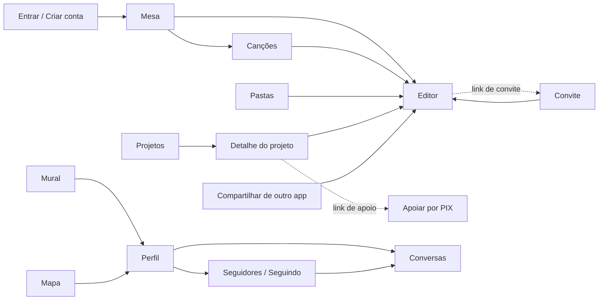

# Telas do Compoze

Uma página por tela: para que serve, o que dá para fazer nela, como foi feita
(arquivos, dados, rotas da API), as decisões tomadas e o porquê, e como ela se
comporta sem internet.

As imagens foram tiradas do modo demonstração (`VITE_API_URL=demo`, ver
[ADR 0003](../decisoes/0003-modo-demo.md)), com a conta de exemplo "Lara
Mendes". Para ver ao vivo: `pnpm dev` e "Entrar como Lara Mendes".

## Mapa das telas

| Tela | Endereço | Página |
| --- | --- | --- |
| Entrar e criar conta | `/login`, `/cadastro` | [entrada.md](entrada.md) |
| Casca do app: menu, abas, busca, estado da rede, avisos | todas | [casca.md](casca.md) |
| Mesa (início) | `/` | [mesa.md](mesa.md) |
| Canções | `/songs` | [cancoes.md](cancoes.md) |
| Editor da canção | `/songs/:id/edit` | [editor.md](editor.md) |
| Pastas | `/folders` | [pastas.md](pastas.md) |
| Projetos e detalhe do projeto | `/projects`, `/projects/:id` | [projetos.md](projetos.md) |
| Apoiar um projeto por PIX | `/apoiar/:id` | [apoiar.md](apoiar.md) |
| Novidades | `/novidades` | [novidades.md](novidades.md) |
| Mural e publicação sozinha | `/feed`, `/posts/:id` | [mural.md](mural.md) |
| Conversas | `/messages`, `/messages/:id` | [conversas.md](conversas.md) |
| Mapa | `/map` | [mapa.md](mapa.md) |
| Perfil, seguidores e seguindo | `/profile`, `/profile/:username`, `…/seguidores`, `…/seguindo` | [perfil.md](perfil.md) |
| Lixeira | `/trash` | [lixeira.md](lixeira.md) |
| Ajustes | `/settings` | [ajustes.md](ajustes.md) |
| Convite por link | `/convite/:token` | [convite.md](convite.md) |
| Compartilhar para o Compoze | `/compartilhar` | [compartilhar.md](compartilhar.md) |
| Primeiros passos e ajuda de cada tela | por cima de qualquer tela | [ajuda.md](ajuda.md) |
| Página não encontrada | qualquer outro endereço | [casca.md](casca.md#página-não-encontrada) |

## Como as telas se encaixam

O menu lateral (no celular, a gaveta e as abas de baixo) leva a qualquer tela
a qualquer momento, e a busca (⌘K / Ctrl+K) acha canções, versos, projetos,
pastas e pessoas de qualquer lugar. Detalhes em [casca.md](casca.md).

## O que vale para todas as telas

- **Linguagem visual "Caderno".** Papel, tinta e um lápis vermelho como único
  acento; réguas finas no lugar de cartões com sombra; a obra em serifa
  (Newsreader) e a ferramenta em grotesca (Hanken Grotesk). O porquê está no
  [design system](../frontend/design-system.md) e no
  [ADR 0002](../decisoes/0002-reescrita-do-frontend.md).
- **Texto que fala como gente.** Estados vazios e erros são frases ("O
  caderno está em branco. Toda canção começa com uma linha só."), não códigos.
  Toda ação perigosa pede confirmação dizendo o que acontece de verdade.
- **Funciona sem internet.** O caderno (canções, pastas, projetos, perfil)
  abre e aceita escrita offline; o que muda espera numa fila e sobe quando a
  rede volta ([ADR 0008](../decisoes/0008-fila-offline-sobre-o-rest.md)). O
  que depende de outra pessoa ou de dinheiro (convites, mural, conversas, PIX)
  pede rede e diz isso no próprio botão.
- **Celular e computador.** Toda tela foi desenhada nas duas larguras. No
  celular, o menu vira gaveta e cinco abas embaixo; no editor, as abas somem
  para dar lugar à barra de inserir blocos.
- **Claro e escuro.** "Papel" e "Noite", ou o que o sistema mandar (Ajustes →
  Aparência).
