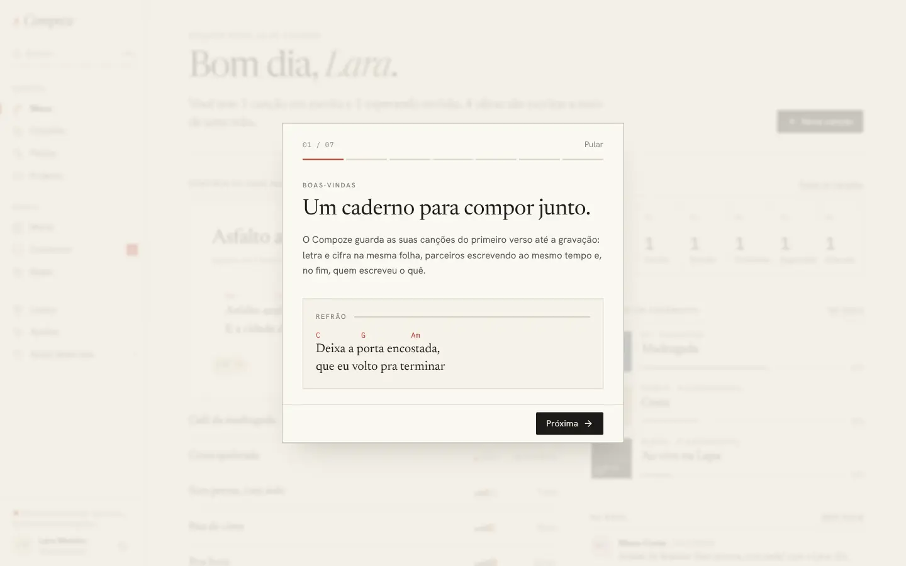
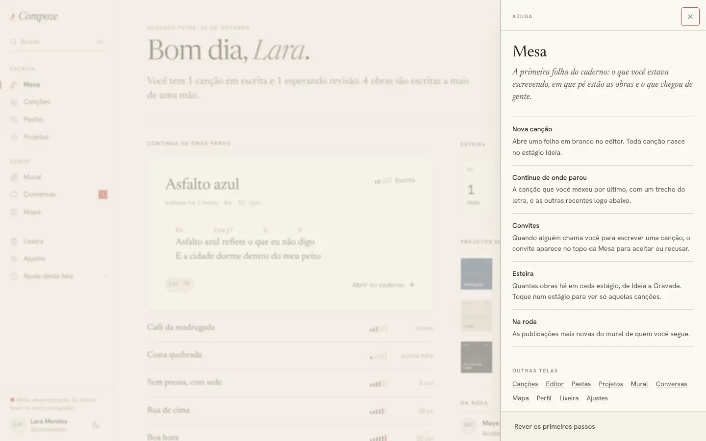

# Primeiros passos e ajuda de cada tela

Aparece por cima de qualquer tela · `apps/web/src/components/ajuda/`
(`PrimeirosPassos.tsx`, `PainelDeAjuda.tsx`), `lib/ajuda.ts`

## Para que serve

Explicar o Compoze para quem chega e tirar dúvidas de quem já usa, sem sair da
tela em que está.

## Primeiros passos

Sete folhas que abrem sozinhas **no primeiro acesso**, numa página no meio da
tela (no celular, tela inteira):

| Folha | Título |
| --- | --- |
| Boas-vindas | Um caderno para compor junto. |
| A folha | A canção se escreve em blocos. |
| Parceria | Cada trecho tem o nome de quem escreveu. |
| Estágios | Toda canção anda de Ideia a Gravada. |
| Organizar | Um lugar para cada coisa, se você quiser. |
| Gente | Quem escreve com você está por perto. |
| No bolso | Dúvida em alguma tela? Toque em Ajuda. |

Cada folha se explica com um pedaço do próprio produto (uma cifra, um verso,
o fio de autoria, o marcador de estágio), como a tela de entrada, e não com
ilustração. Anda com **Próxima** e **Voltar**, com as setas do teclado ou
deslizando no celular; **Pular** fecha.

Abre **uma vez por conta, neste aparelho**: o "já viu" fica no `localStorage`
(`compoze.primeirosPassos.<id da pessoa>`), e fechar de qualquer jeito conta
como visto. Não abre em `/convite`, `/apoiar` e `/compartilhar`: quem chegou
por esses links veio fazer uma coisa só, e o passeio espera a próxima tela.

Para rever: Ajustes → Ajuda → "Rever os primeiros passos", o rodapé do painel
de ajuda ou a busca (⌘K → "Primeiros passos").

## Ajuda desta tela

Um painel que entra pela direita com o que a tela aberta faz, item por item
(na Mesa: Nova canção, Continue de onde parou, Convites, Esteira, Na roda), e
links para a ajuda das outras telas. Abre:

- pelo ícone **?** no topo, no celular;
- por **"Ajuda desta tela"** no menu, no computador;
- pela tecla **?**, fora de campos de texto (a letra de uma canção pode ter
  "?");
- pela busca (⌘K → "Ajuda desta tela").

## Como foi feita

- Todo o texto mora em `lib/ajuda.ts`: as folhas, os tópicos de cada tela e o
  mapa de rota → tópico. Assim a ajuda de uma tela pode ser lida de outra, e
  um rótulo que muda é corrigido num lugar só.
- Um store pequeno (`useAjuda`) guarda o que está aberto; a casca monta o
  painel e o passeio e abre o passeio quando a pessoa ainda não o viu.
- `ajuda.test.ts` cobre o mapa de rotas e **exige ajuda para toda tela do
  menu**: uma tela nova sem ajuda quebra o teste.

## Decisões e porquês

| Decisão | Por quê |
| --- | --- |
| Folhas em vez de balões apontando para botões | Balões quebram com o layout que muda entre celular e computador, com o editor que esconde as abas e com telas que carregam depois; e têm cara de produto genérico ([ADR 0020](../decisoes/0020-primeiros-passos-e-ajuda.md)) |
| "Já viu" no aparelho, não no servidor | Não pede migração, rota e contrato para algo que se pula com um toque. O preço é ver o passeio uma vez em cada aparelho |
| Botão de ajuda na casca, não em cada página | Várias telas não usam o mesmo cabeçalho; na casca, ele fica no mesmo lugar em todas |
| Um arquivo só para o texto | A ajuda não fica desatualizada em silêncio quando um botão muda de nome |

## Sem internet

Funciona: o texto vem com o app.
