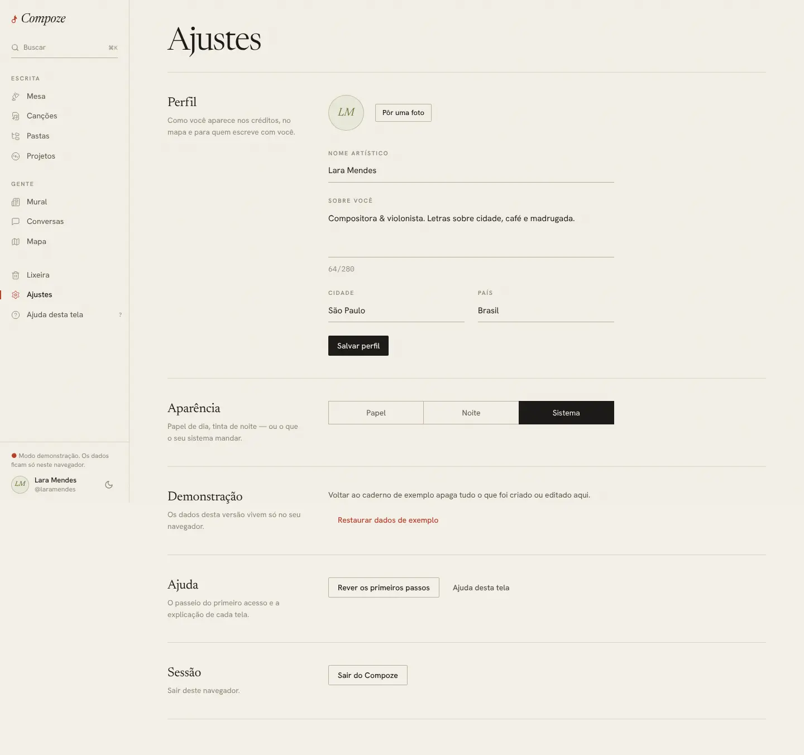

# Ajustes

`/settings` · `apps/web/src/pages/app/Settings.tsx`, `lib/avisos.ts`,
`lib/tema.ts`, `lib/atualizacao.ts`

## Para que serve

Tudo o que é da pessoa e do aparelho, e não de uma canção: perfil, aparência,
avisos, versão do app, senha e sair.

Cada seção é um bloco com o título e uma frase à esquerda e os controles à
direita. Algumas só aparecem onde fazem sentido.

## As seções

| Seção | O que faz | Aparece |
| --- | --- | --- |
| **Perfil** | Foto ("Pôr uma foto", "Trocar foto", "Tirar foto"), capa do perfil ("Pôr uma capa", "Trocar capa", "Tirar capa"), nome artístico, "Sobre você" (até 280 caracteres, com contador), cidade e país. **Salvar perfil** | sempre |
| **Aparência** | Tema **Papel**, **Noite** ou **Sistema** | sempre |
| **Avisos** | Liga ou desliga, **neste aparelho**, os avisos do sistema de mensagem nova, convite, seguidor novo e apoio por PIX, mesmo com o Compoze fechado | onde o navegador ou o app recebe avisos |
| **Ajuda** | **Rever os primeiros passos** e **Ajuda desta tela** ([ajuda.md](ajuda.md)) | sempre |
| **Demonstração** | "Restaurar dados de exemplo", que apaga o que foi feito na demo | só no modo demonstração |
| **Aplicativo** | Versão instalada, **Procurar atualização** e **Baixar a versão nova** | só no app Android |
| **Senha** | Senha nova e repetição, sem pedir a atual. Este aparelho continua dentro; nos outros, é preciso entrar de novo | fora da demonstração |
| **Sessão** | **Sair do Compoze** | sempre |

### Avisos, caso a caso

A frase muda conforme o aparelho:

- "Ligados neste aparelho." / "Desligados neste aparelho."
- **Bloqueado pelo navegador**: explica como liberar no cadeado ao lado do
  endereço.
- **iPhone no Safari**: avisos só funcionam com o Compoze instalado na tela de
  início (Compartilhar → Adicionar à Tela de Início).
- **Servidor sem Firebase**: no APK, diz que o servidor ainda não está pronto
  para avisos no Android.

## Como foi feita

- **Perfil**: `updateCurrentUser` no store, pela fila offline
  (`PATCH /users/me`). A foto é reduzida no aparelho para 512 px e sobe por
  `PUT /users/me/avatar`; a capa, para 1600 px, por `PUT /users/me/cover`.
  As duas pedem rede ([ADR 0015](../decisoes/0015-imagens-no-postgres.md),
  [ADR 0021](../decisoes/0021-ajustes-do-primeiro-teste.md)).
- **Tema**: `lib/tema.ts` guarda a escolha no navegador e aplica a classe no
  `<html>`; "Sistema" segue `prefers-color-scheme`.
- **Avisos**: `lib/avisos.ts` tem dois caminhos. No navegador e na PWA, **Web
  Push** com as chaves VAPID que a própria API gera (`GET /push/public-key`,
  `PUT /push/subscriptions`). No APK, **Firebase Cloud Messaging** pelo plugin
  do Capacitor. O app já pede a permissão ao abrir; quem desliga aqui não é
  perguntado de novo ([ADR 0016](../decisoes/0016-avisos-por-push.md)).
- **Aplicativo**: compara a versão do APK com o último Release do GitHub
  (`lib/atualizacao.ts`); o botão abre o link do APK novo no navegador do
  celular ([ADR 0011](../decisoes/0011-app-android-fora-da-loja.md)).
- **Senha**: `POST /auth/password`. O servidor troca a senha, **revoga todos
  os tokens de renovação** e devolve um par novo para este aparelho
  ([ADR 0019](../decisoes/0019-senha-nova-sem-a-atual.md)).
- **Sair** apaga a sessão, a cópia local do caderno e dos documentos, a fila e
  a inscrição de avisos deste aparelho. O que ainda não tinha subido se perde
  de propósito: a próxima pessoa a usar o aparelho pode ser outra.

## Decisões e porquês

| Decisão | Por quê |
| --- | --- |
| Senha nova sem a atual | Veio de um caso real (senha esquecida, sessão aberta no celular), e ainda não há "esqueci a senha" por e-mail. Quem tem a sessão aberta já provou quem é; e a troca derruba as outras sessões, o que também serve para expulsar um aparelho perdido ([ADR 0019](../decisoes/0019-senha-nova-sem-a-atual.md)) |
| Avisos por aparelho | Cada aparelho tem a sua inscrição. A pessoa pode querer aviso no celular e não no computador do trabalho |
| "Papel" e "Noite" em vez de "claro" e "escuro" | O vocabulário do caderno, coerente com o resto |
| Seções que só aparecem onde fazem sentido | Um botão que não funciona naquele aparelho é pior do que nenhum |

## Sem internet

Perfil (menos a foto e a capa) e tema funcionam. Avisos, versão do app e senha pedem
internet.
