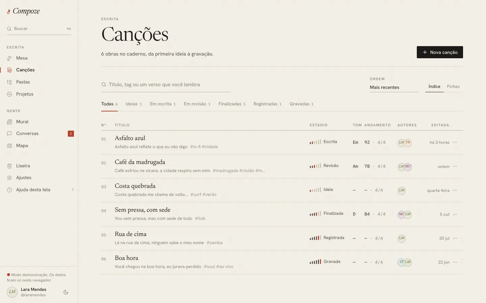
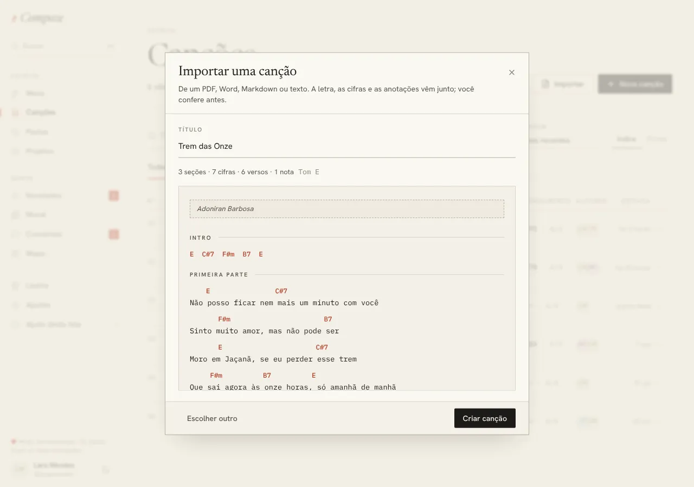
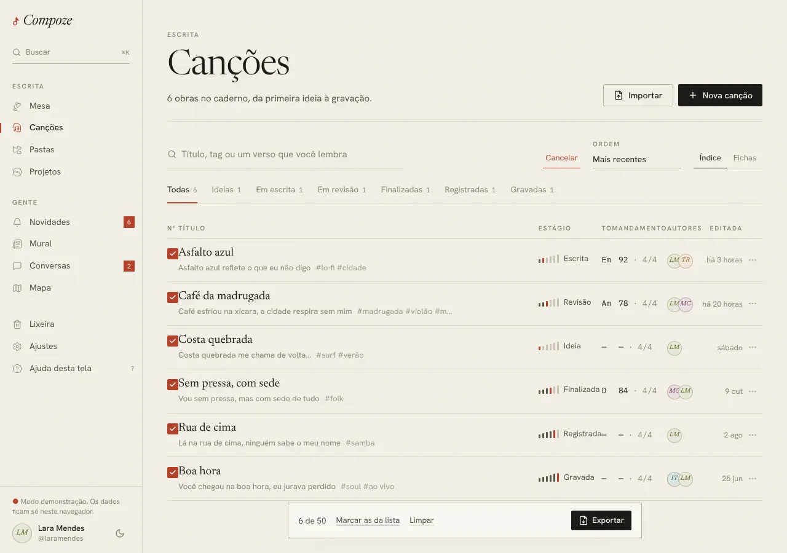
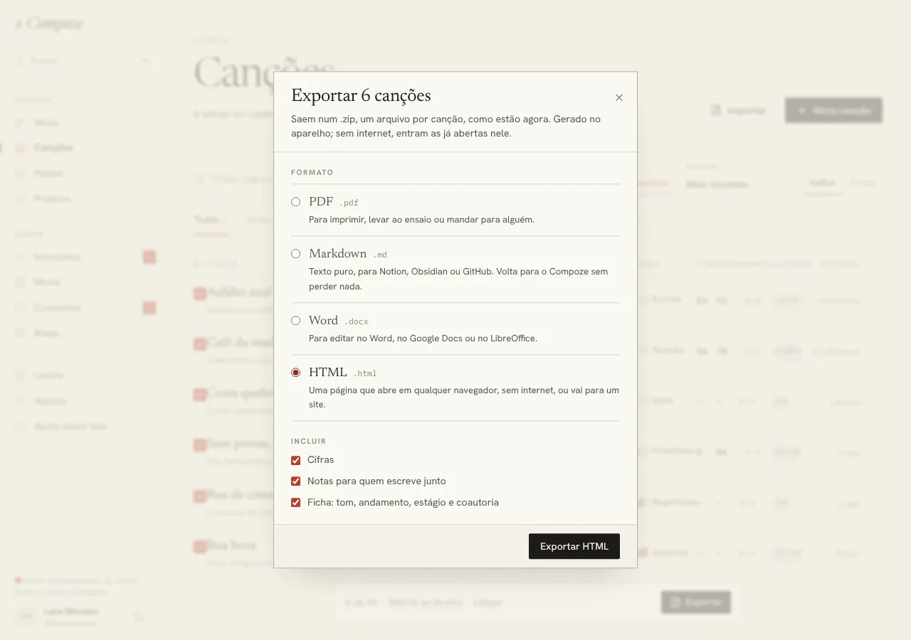
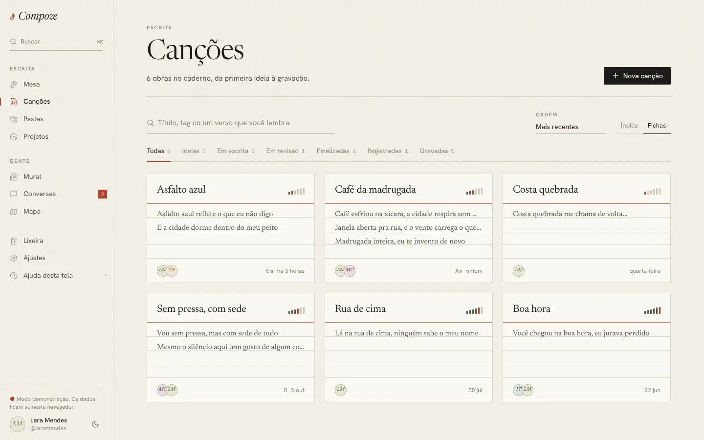

# Canções

`/songs` (com `?estagio=` e `?q=`) · `apps/web/src/pages/app/Songs.tsx`

## Para que serve

O índice de todas as obras do caderno, as que a pessoa criou e as que escreve
com outras pessoas. Serve para achar uma canção, ver em que pé cada uma está e
abrir no editor.

## O que dá para fazer

- **Buscar** por título, tag ou um verso que se lembra ("Título, tag ou um
  verso que você lembra").
- **Filtrar por estágio** nas abas: Todas, Ideias, Em escrita, Em revisão,
  Finalizadas, Registradas, Gravadas, cada uma com a contagem.
- **Ordenar**: mais recentes, mais antigas, por estágio, por título (ordem
  alfabética do português).
- **Trocar a exibição** entre **Índice** e **Fichas**:
  - Índice é uma tabela numerada: título com o primeiro verso e as tags,
    estágio, tom, andamento e compasso, autores e quando foi editada. No
    celular as colunas menos importantes somem.
  - Fichas são cartões pautados, como fichas de arquivo, com as três
    primeiras linhas da letra. **Duas por linha já no celular**, mais
    compactas; três no computador e quatro nas telas largas
    ([ADR 0021](../decisoes/0021-ajustes-do-primeiro-teste.md)).
- **Nova canção**, que abre direto no editor.
- **Importar** uma canção de um PDF, Word, Markdown, texto ou ChordPro, ou
  colando o texto. Arrastar o arquivo para a janela também vale. Antes de
  criar, a prévia mostra a folha como vai ficar (seções, cifras, versos,
  notas e o tom) e o título pode ser mudado. A canção nasce como ideia e abre
  no editor, com o **Alinhar** ligado se veio cifra. Como a leitura entende
  cada formato está em [Editor › Importar e exportar](editor.md#importar-e-exportar).

- **Exportar várias de uma vez**: **Selecionar** (ao lado da ordem) põe uma
  caixinha em cada canção, e tocar numa canção marca em vez de abrir. A barra
  de baixo mostra quantas estão marcadas, do máximo de 50, e tem **Marcar as
  da lista** (vale o filtro e a busca), **Limpar** e **Exportar**. O diálogo
  é o mesmo do editor (PDF, Markdown, Word ou HTML, com ou sem cifras, notas
  e ficha), e as canções saem num .zip, uma por arquivo, na ordem da lista.
  Sem internet, entram as já abertas no aparelho, e o aviso diz quais
  ficaram de fora ([ADR 0025](../decisoes/0025-html-e-exportar-varias.md)).
- **Exportar…** no menu `…` de cada linha, para uma canção sem abrir o
  editor.
- **Mover para a lixeira** pelo menu `…` de cada linha, com "Desfazer" no
  aviso que aparece.

## Como foi feita

- Lê as canções ativas do store do caderno (`listActive` tira as que estão na
  lixeira). Filtro, busca e ordem são calculados no aparelho com `useMemo`, sem
  chamar a API.
- **Filtro e busca moram no endereço** (`?estagio=revisao&q=lua`). Assim a
  Esteira da Mesa linka direto para um estágio, e voltar do editor devolve a
  pessoa à mesma lista.
- A pauta das fichas é um `repeating-linear-gradient` com a cor das réguas,
  linha a cada 28 px, alinhada à altura da linha do texto.
- O marcador de estágio (`components/compoze/Estagio.tsx`) é uma pequena
  escada de seis traços, com o traço do estágio atual em vermelho: dá para ler
  a posição no fluxo sem ler a palavra.

## Decisões e porquês

| Decisão | Por quê |
| --- | --- |
| Busca também nos versos | Quem compõe muitas vezes lembra de um trecho e não do título, que às vezes nem existe ainda |
| Clicar na canção abre o editor, sem pré-visualização | O editor tem modo de leitura (esconder cifras); um modal no meio era um passo a mais ([ADR 0002](../decisoes/0002-reescrita-do-frontend.md)) |
| Excluir manda para a lixeira, com Desfazer | Exclusão reversível é regra do produto (RN07); 30 dias para restaurar (RN08) |
| Índice como padrão | É o que mais cabe na tela e lembra o índice de um caderno; as fichas ficam para quem prefere ver a letra |

## Sem internet

Tudo funciona: a lista vem do aparelho, e criar ou excluir canção entra na
fila e sobe quando a rede volta.
