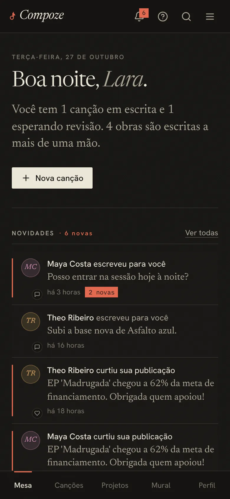
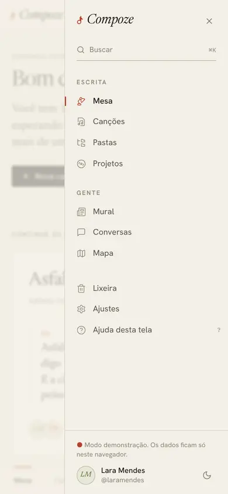
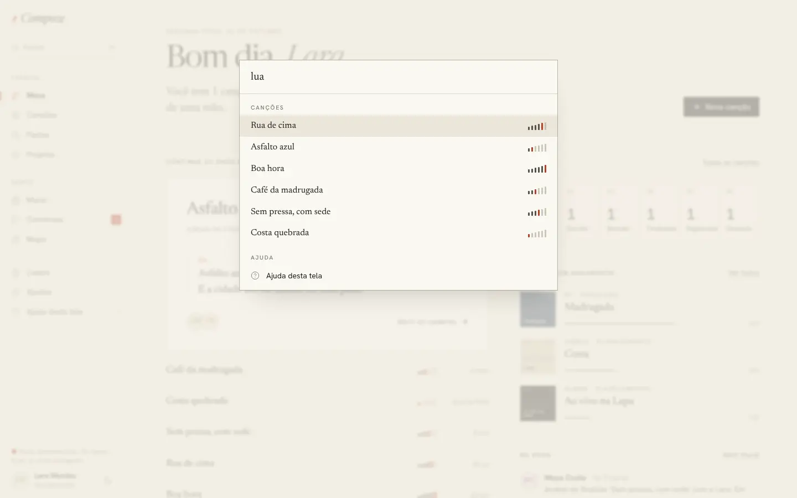
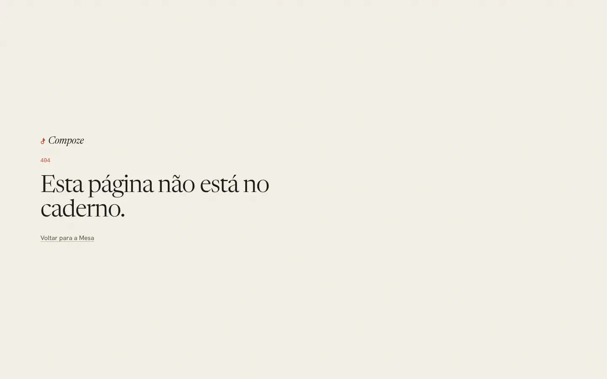

# Casca do app: menu, abas, busca e avisos

Tudo o que envolve as telas depois do login · `apps/web/src/components/layout/`
(`AppLayout.tsx`, `navegacao.ts`), `components/auth/RequireAuth.tsx`,
`components/compoze/BuscaGlobal.tsx`, `components/gente/AoVivo.tsx`

## Para que serve

A casca é a moldura fixa: o menu para ir a qualquer seção, a busca, o estado
da sincronização, o tema e os avisos que chegam enquanto o app está aberto.
Ela também decide se a pessoa pode ver uma tela (sessão) e espera os dados
chegarem antes de mostrar qualquer coisa.

## O menu (trilho)

No computador, um trilho fixo à esquerda, com 232 px:

| Grupo | Itens |
| --- | --- |
| **Escrita** | Mesa, Canções, Pastas, Projetos |
| **Gente** | Mural, Conversas (com o número de não lidas), Mapa |
| Rodapé | Lixeira, Ajustes, **Ajuda desta tela** (tecla `?`) |

Acima, o campo "Buscar ⌘K". Embaixo, a pessoa (monograma, nome e `@`, que
levam ao perfil) e o botão de tema claro/escuro. A seção ativa ganha um traço
de lápis vermelho à esquerda e o ícone em vermelho.

No celular, o topo tem **Ajuda** (?), Buscar e ☰; o trilho vira uma **gaveta** e aparecem **cinco
abas fixas embaixo**: Mesa, Canções, Projetos, Mural, Perfil. No editor as
abas somem: o espaço de baixo é da barra de inserir blocos.

**Por quê:** as duas metades do produto (escrever e gente) ficam separadas no
menu porque são usos diferentes; quem abre o app para escrever não precisa
atravessar o social. No celular, as cinco abas são as telas mais visitadas,
e o resto fica a um toque, na gaveta. Os ícones são de traço fino (lucide),
iguais no menu e na busca.

## Estado da rede, no pé do menu

Uma linha discreta, que some quando está tudo no servidor:

- "Sem internet. 3 mudanças neste aparelho; sobem quando a rede voltar."
- "Enviando 2 mudanças…"
- "Conectando ao servidor. Pode escrever: o que mudar sobe em seguida." (a
  API dormindo no Render grátis; só aparece se a leitura passar de 3 s, para
  não piscar a cada abertura)
- No modo demonstração: "Modo demonstração. Os dados ficam só neste navegador."

**Por quê:** offline não é erro, então não é um alerta vermelho. A pessoa só
precisa saber que o que escreveu está guardado e que vai subir
([ADR 0008](../decisoes/0008-fila-offline-sobre-o-rest.md)).

## Busca (⌘K / Ctrl+K)

Abre um painel no meio da tela que acha, enquanto se digita:

- **Canções**, pelo título, pelas tags e por qualquer verso (quem lembra de um
  trecho e não do título acha do mesmo jeito);
- **Projetos** e **pastas**;
- **Pessoas**, pelo nome ou `@`: primeiro quem já está no caderno e, com
  internet, qualquer conta do Compoze (`GET /users?q=`, sem acento);
- **Ir para**: as seções do menu;
- **Ajuda**: "Ajuda desta tela" e "Primeiros passos" ([ajuda.md](ajuda.md)).

**Como foi feita:** `cmdk` dentro de um diálogo Radix. Tudo, menos as pessoas
de fora, vem do que já está carregado no aparelho; por isso a busca é
instantânea e funciona offline. A busca de pessoas na API espera 250 ms entre
letras.

## Guarda de rota e carga inicial (`RequireAuth`)

1. Na abertura, tenta restaurar a sessão. Quem já entrou no aparelho abre
   **na hora**, com a última sessão e a cópia local do caderno; a sessão é
   conferida em segundo plano e, se o servidor recusar, o app sai.
2. Sem sessão, manda para `/login` guardando o destino (com a busca, para não
   perder um texto compartilhado).
3. Com sessão, carrega o caderno (`hydrate`): primeiro a cópia do IndexedDB,
   depois esvazia a fila de mudanças offline, só então relê o servidor.
4. Enquanto isso mostra "Verificando sessão…" ou "Carregando suas
   composições…", com a marca pulsando. Se a carga falhar, oferece "Tentar
   novamente".

**Por quê:** sem esperar a carga, as telas recebiam dados vazios e quebravam
(tela em branco). E a sessão não é conferida antes de abrir porque a API pode
levar um minuto para acordar: ninguém deveria esperar isso para ler a própria
letra.

## Avisos dentro do app

- **Mensagem nova** com o app aberto: um aviso embaixo ("Maya: Posso entrar
  na sessão hoje à noite?") com "Abrir", a não ser que a conversa já esteja
  aberta (`AoVivo.tsx`, que mantém o fluxo ao vivo `GET /events`,
  [ADR 0014](../decisoes/0014-conversas-ao-vivo.md)).
- **Pedido de permissão para avisos do sistema** logo ao abrir. Onde o
  navegador só pergunta depois de um toque (Safari, Firefox), aparece a nota
  "Quer saber na hora quando chegar mensagem ou convite?" com "Ligar avisos"
  ([ADR 0016](../decisoes/0016-avisos-por-push.md)).
- **Algo feito offline foi recusado** pelo servidor (a permissão mudou, outra
  pessoa apagou a canção): "Não deu para salvar …" e o caderno é relido.
- **Versão nova**: na PWA, "Há uma versão nova do Compoze" com "Atualizar"; no
  APK, uma vez por dia o app confere os Releases do GitHub e oferece "Baixar".

Todos usam o `sonner`, sem estilo próprio dele: borda fina, papel, texto em
tinta, ação em lápis.

## Outras coisas que a casca faz ao abrir

- Abre os **Primeiros passos** no primeiro acesso da conta neste aparelho
  ([ajuda.md](ajuda.md), [ADR 0020](../decisoes/0020-primeiros-passos-e-ajuda.md)).
- Pede **armazenamento persistente** ao navegador, para ele não apagar o
  caderno do aparelho quando faltar espaço (`lib/pwa.ts`).
- Renova a inscrição de avisos (`renovarAvisos`).
- No APK, escuta o toque num aviso do sistema e abre a conversa.
- Recebe texto compartilhado de outro app e leva a
  [/compartilhar](compartilhar.md).
- Baixa em segundo plano o código de todas as telas, para que continuem
  abrindo se a rede cair depois (`App.tsx`).

## Página não encontrada

Qualquer endereço desconhecido: "404 · Esta página não está no caderno." com
"Voltar para a Mesa" (`pages/NotFound.tsx`).
