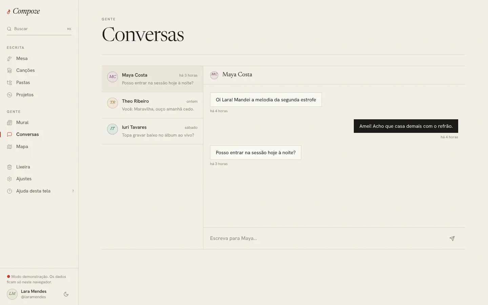
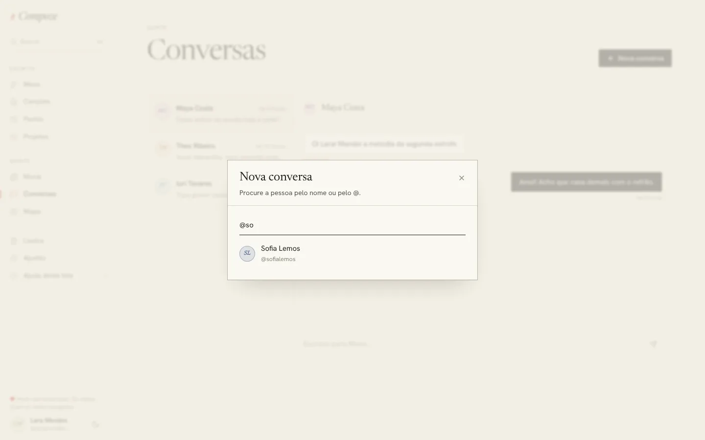

# Conversas

`/messages` e `/messages/:id` · `apps/web/src/pages/app/Messages.tsx`,
`components/gente/conversas.ts`, `NovaConversa.tsx`, `AoVivo.tsx`, `lib/aoVivo.ts`,
`apps/api/src/lib/aoVivo.ts`

## Para que serve

Conversar a dois com quem se escreve junto (ou com quem se quer escrever), sem
sair do Compoze para combinar ensaio, mandar uma ideia de melodia ou acertar a
divisão.

## O que dá para fazer

- Ver a **lista de conversas**: nome, a última mensagem ("Você: …" quando foi a
  própria), quando, e o número de **não lidas** em vermelho. O mesmo número
  aparece no menu, ao lado de "Conversas".
- Abrir uma conversa e **escrever** (até 4.000 caracteres). As próprias
  mensagens ficam à direita, em tinta; as da outra pessoa, à esquerda, em
  papel.
- **Mensagens anteriores**, em páginas.
- **Nova conversa**, no alto da tela: abre uma janela para procurar a pessoa
  pelo nome ou pelo @, em todas as contas do Compoze (a mesma busca do
  convite, `GET /users?q=`). Com o campo vazio, a janela mostra quem você
  segue. Quem já tem conversa com você aparece com "já conversam"; escolher
  essa pessoa só abre a conversa que existe.

  

- **Começar uma conversa** também pelo "Conversar" do perfil de alguém ou pelo
  "Mensagem" da lista de seguidores. Os três caminhos levam ao mesmo endereço,
  `/messages?com=<id>`, que abre a conversa que já existe ou cria uma.
- No computador, a conversa mais recente abre sozinha; no celular, a lista e a
  conversa são telas separadas, com ← para voltar.

## Como foi feita

- **Ao vivo por Server-Sent Events.** Enquanto há sessão, o `AoVivo` (montado
  na casca) mantém aberto `GET /events`, lido com `fetch` para levar o token
  no cabeçalho. Cada mensagem nova chega na hora, nos dois lados e em todos os
  aparelhos da pessoa; o evento entra no cache da conversa
  (`guardarMensagem`) e a lista é relida. Fora da conversa, aparece um aviso
  com "Abrir". Se a conexão cai, reconecta com espera crescente e relê o que
  pode ter chegado.
- No servidor, um "hub" em memória (`apps/api/src/lib/aoVivo.ts`) sabe quem
  está conectado e entrega a cada um. Funciona porque a API roda numa
  instância só.
- **Lida** quando a conversa está aberta e chega mensagem da outra pessoa
  (`POST /conversations/{id}/read`); o outro lado recebe o evento `read`.
- **Avisos com o app fechado:** se a pessoa não tem nenhum fluxo ao vivo
  aberto, a mensagem vira aviso do sistema (Web Push ou Firebase,
  [ADR 0016](../decisoes/0016-avisos-por-push.md)). O app fecha o fluxo ao
  vivo quando vai para segundo plano, para o servidor saber que é hora de
  avisar.
- Tabelas `conversations` (com uma chave única por par de pessoas, para nunca
  haver duas conversas entre as mesmas duas), `conversation_members` (com
  `last_read_at`) e `messages` (migração 0011).

## Decisões e porquês

| Decisão | Por quê |
| --- | --- |
| Só conversas a dois | Cobre o uso principal (combinar com a parceria). Grupos pedem moderação, papéis e outra interface ([ADR 0014](../decisoes/0014-conversas-ao-vivo.md)) |
| SSE em vez de WebSocket | É só do servidor para o aparelho, passa por qualquer proxy, reconecta sozinho e não precisa de outra peça; o envio continua sendo um `POST` normal |
| Hub em memória, sem Redis | Uma instância só no plano grátis. Com mais de uma, o hub passa a precisar de um canal entre elas (Postgres `LISTEN/NOTIFY` ou Redis) |
| "Nova conversa" na própria tela | Antes só dava para começar pelo perfil, o que obrigava a sair de Conversas e achar a pessoa antes. A janela reaproveita a busca de pessoas e o `?com=`, sem rota nova na API |
| Sugestões são quem você segue | É a lista de gente mais provável para conversar e já existe (`GET /users/{id}/following`); evita uma janela vazia |
| Mensagens não têm cópia offline | Conversa é tempo real; mandar uma mensagem que só sai horas depois confunde mais do que ajuda |

## Sem internet

"Conversas precisam de internet." O campo de escrever fica desligado. Uma
mensagem que não saiu volta para o campo, para não se perder.
