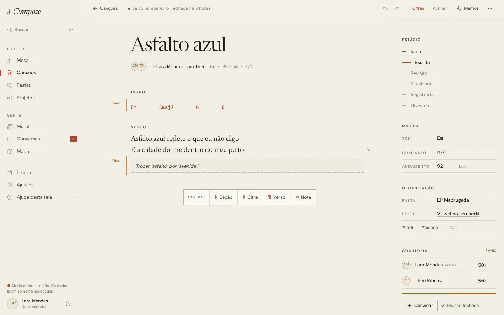
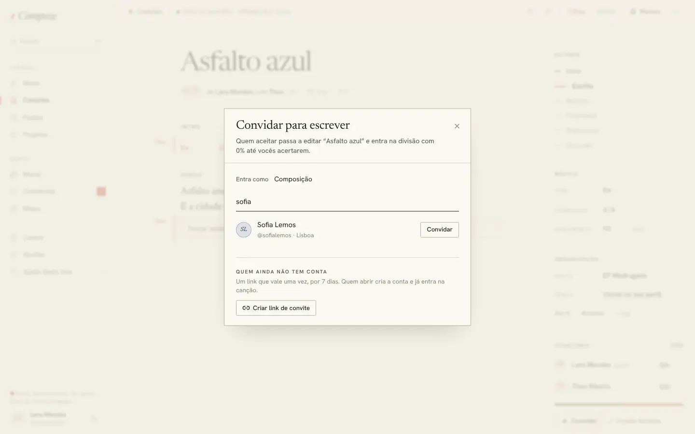
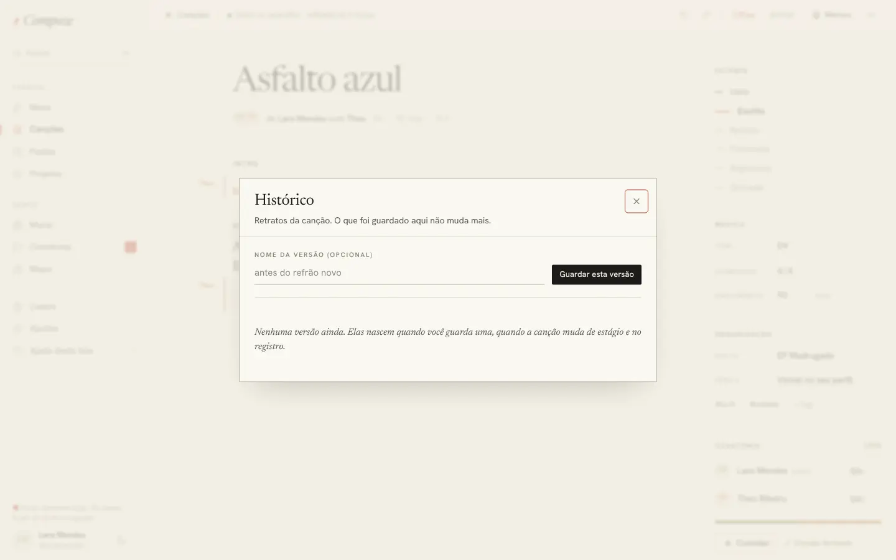
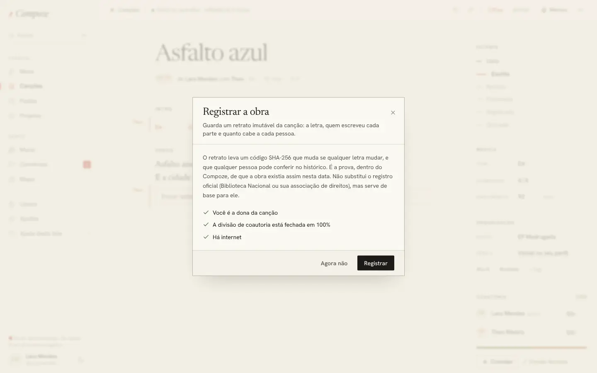
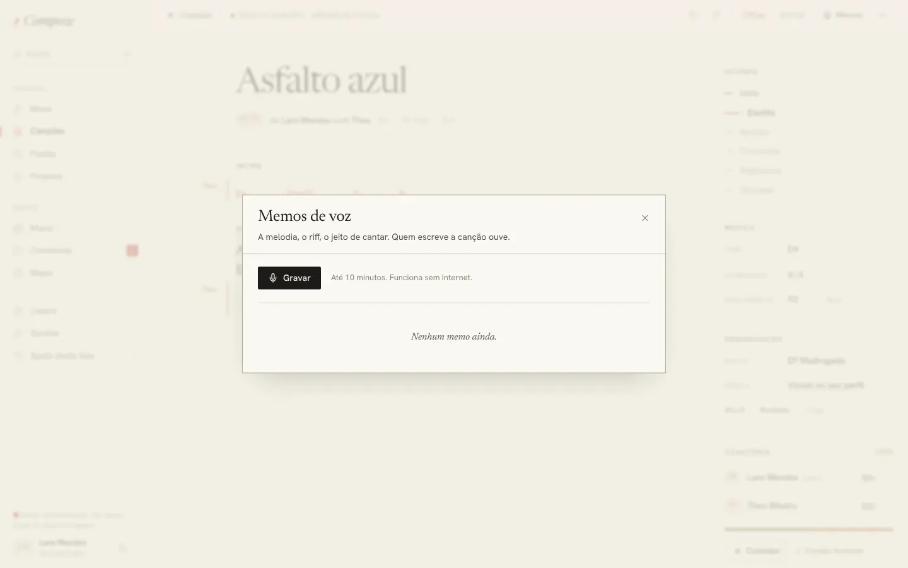
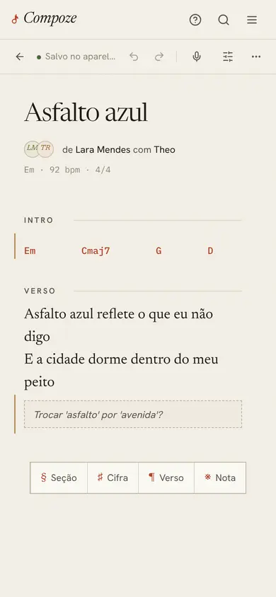
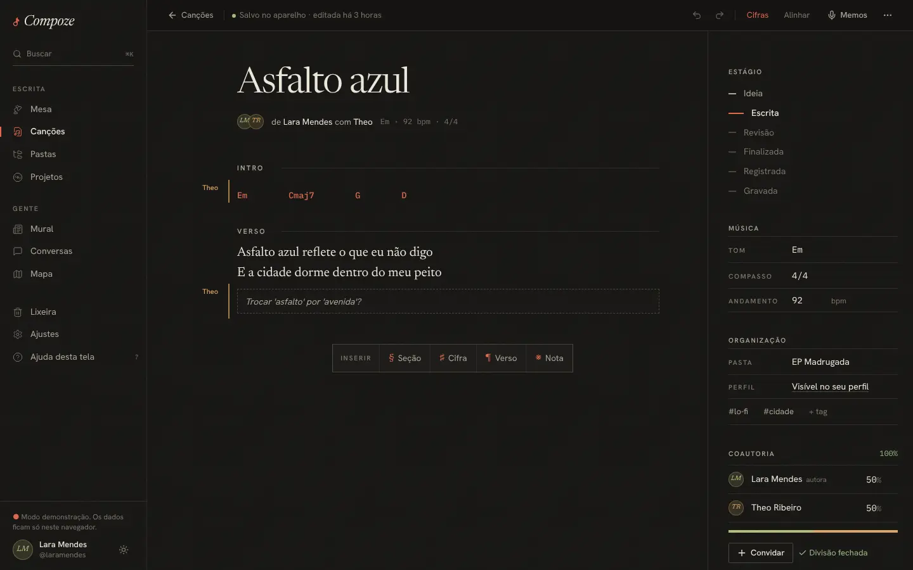

# Editor da canção

`/songs/:id/edit` · `apps/web/src/pages/app/SongEditor.tsx` e
`components/editor/` (`Bloco`, `FichaTecnica`, `Convidar`, `Historico`,
`Memos`), `hooks/useDocumentoDaCancao.ts`, `packages/documento`

## Para que serve

É o coração do Compoze: a folha onde a canção é escrita, sozinho ou junto, em
tempo real, com ou sem internet. Cada trecho guarda quem o escreveu, e a
margem direita guarda tudo o que não é letra: estágio, tom, andamento, pasta,
tags e a divisão de coautoria.

A tela tem três partes: a **barra do documento** no topo, a **folha** no meio
e a **ficha técnica** na margem direita (no celular e em telas médias, a
ficha abre por cima, pelo botão "Ficha").

## A folha: escrever em blocos

A canção é uma lista de blocos, de quatro tipos, inseridos pela barra
"Inserir" que fica grudada embaixo enquanto a folha rola:

| Bloco | Marca | Como aparece | Para quê |
| --- | --- | --- | --- |
| **Seção** | § | Rótulo em versalete com uma régua ("VERSO", "REFRÃO", "PONTE") | Dividir a canção em partes |
| **Cifra** | ♯ | Linha monoespaçada em lápis vermelho | Os acordes, acima do verso que acompanham |
| **Verso** | ¶ | Serifa grande | A letra |
| **Nota** | ※ | Caixa tracejada, em itálico | Uma anotação para quem escreve junto ("Trocar 'asfalto' por 'avenida'?") |

Teclado:

- **Enter** num verso ou numa cifra cria um verso logo abaixo (cifra é uma
  linha só; Enter segue para a letra que ela acompanha). Shift+Enter quebra a
  linha dentro do bloco.
- **Backspace** num bloco vazio apaga o bloco e volta para o anterior.
- **Enter no título** pula para o primeiro bloco.
- **Ctrl+Z / Ctrl+Shift+Z (ou Ctrl+Y)** na folha desfaz e refaz.

**Onde o bloco novo entra:** abaixo do bloco em que está o cursor. Uma cifra
pedida com o cursor num verso entra **acima** dele, que é onde a cifra fica
numa folha de papel. Sem cursor, no fim.

Cada bloco cresce com o próprio texto (sem barra de rolagem) e tem um `×` que
aparece ao passar o mouse ou ao focar, para remover.

### Autoria como marginália

Todo bloco guarda quem o escreveu. Os trechos de outra pessoa ganham **um fio
na cor dela** à esquerda e, no começo de cada sequência dela, **o primeiro
nome na margem**, como anotações a lápis num manuscrito. Os próprios trechos
ficam sem marca, para não poluir. As cores (índigo, oliva, ocre, ameixa,
petróleo) são dessaturadas de propósito, para conviverem no mesmo texto sem
virar arco-íris, e cada pessoa tem sempre a mesma, derivada do id.

**Por quê:** a autoria por trecho é a base da prova de coautoria (quem
escreveu o quê) e uma das razões de o Compoze existir. Ela precisa estar
sempre visível, mas sem atrapalhar a leitura da letra.

### Escrever junto, em tempo real

Com outra pessoa na mesma canção:

- a barra mostra os monogramas e "aqui agora";
- a margem do bloco em que ela está mostra "Theo *escrevendo*", na cor dela
  (isso tem precedência sobre a assinatura, porque muda o que se faz em
  seguida);
- o que cada um digita aparece no outro na hora, sem conflito, mesmo que os
  dois escrevam no mesmo verso.

**Como:** o conteúdo da canção é um **documento Yjs** (um CRDT), um por
canção, definido em `packages/documento` e usado pelo front e pela API. No
aparelho, ele fica salvo no IndexedDB (`y-indexeddb`); com rede, sincroniza
por WebSocket com o Hocuspocus, que roda dentro da própria API em `/collab`.
O servidor projeta o documento na tabela `song_blocks`, que é o que as listas,
a busca e as versões leem. Decisão e alternativas no
[ADR 0007](../decisoes/0007-documento-yjs-da-cancao.md).

**Desfazer** é do `Y.UndoManager`: desfaz só o que **esta** pessoa fez,
inclusive inserir e remover blocos. A edição de quem escreve junto não volta.
Título e ficha usam o desfazer do próprio campo.

### A barra do documento

Da esquerda para a direita:

- **← Canções**, que volta ao índice (com o filtro que estava).
- **Onde está o que foi escrito**, com uma bolinha de cor:

  | Estado | Quando |
  | --- | --- |
  | Abrindo… | lendo a cópia do aparelho |
  | Sincronizando… | há mudança daqui que o servidor ainda não confirmou |
  | Salvo · editada há 3 horas | servidor e aparelho iguais |
  | Offline · salvo no aparelho | sem conexão; sobe depois |
  | Salvo no aparelho | modo demonstração, sem servidor |
  | Sem acesso para escrever | o servidor recusou (convite só de leitura, canção na lixeira) |

- **Desfazer / Refazer.**
- **Cifras**: esconde as cifras para ler só a letra (o botão fica riscado).
- **Alinhar**: passa a letra para fonte monoespaçada, para acorde e sílaba
  coincidirem na vertical.
- **Memos** (microfone), **Ficha** (no celular) e **`…`**: Histórico de
  versões, Copiar link, Mover para a lixeira.

As preferências de Cifras e Alinhar ficam guardadas no navegador.

## A ficha técnica (margem direita)

- **Estágio**: a escada Ideia → Escrita → Revisão → Finalizada → Registrada →
  Gravada. Um clique muda o estágio, menos **Registrada**, que abre
  "Registrar a obra" (abaixo). Cada mudança de estágio guarda uma versão
  sozinha.
- **Música**: tom (maiores e menores, com sustenidos e bemóis), compasso
  (2/4 a 12/8) e andamento em bpm.
- **Organização**: pasta (ou "Sem pasta"), visibilidade no perfil ("Visível no
  seu perfil" / "Privada — só coautores veem") e tags (`+ tag`, Enter ou
  vírgula para adicionar).
- **Coautoria**: cada pessoa com o seu percentual, a soma no alto (verde em
  100%, vermelha fora disso) e uma barra em que cada pessoa ocupa a sua
  fração na cor dela. Botões **Convidar** (só a dona) e **Fechar divisão**.

### Regras da coautoria (RN05)

Enquanto negociam, a soma pode ser qualquer valor. **Fechar a divisão** exige
exatamente 100% e pede internet, porque o servidor decide na hora. Mudar
qualquer percentual depois reabre a divisão. Só a dona remove coautores.

**Por quê:** na vida real, a divisão é conversada aos poucos. O app não deve
impedir rascunhos, mas a obra só pode ser registrada com uma divisão que todo
mundo fechou.

## Convidar para escrever

Só a dona convida. Primeiro escolhe o papel ("Entra como": Composição, Letra,
Arranjo e instrumentos, Produção ou Só leitura). Depois:

- **Pela conta**: busca por nome ou `@` em todo o Compoze. A pessoa recebe o
  convite na Mesa dela (e um aviso no celular) e **aceita ou recusa**. Ninguém
  entra numa canção sem aceitar.
- **Por link**, para quem ainda não tem conta: um link que vale **uma vez,
  por 7 dias**. Quem abre cria a conta e já entra na canção. O link aparece
  uma vez só ("Guarde agora"), com Copiar e, no celular, Compartilhar. O
  servidor guarda só o hash do token.
- **Por e-mail**, quando o envio estiver ligado no servidor: o mesmo link vai
  por e-mail. O campo só aparece se estiver ligado.

Embaixo, "Esperando resposta" lista os convites abertos, com o prazo e a
opção de cancelar. Quem entra começa com 0% na divisão.

Decisões no [ADR 0010](../decisoes/0010-convites.md) (convite estilo rede
social, aceite obrigatório, link de uso único) e no
[ADR 0017](../decisoes/0017-email-por-smtp.md) (e-mail pelo Gmail sem
domínio).

## Histórico de versões e registro

**Histórico** (menu `…`): retratos imutáveis da canção (título, estágio,
blocos com o autor de cada um e a divisão de coautoria). Uma versão nasce:

- quando alguém clica em **Guardar esta versão** (com um nome opcional, "antes
  do refrão novo");
- quando a canção **muda de estágio**;
- no **registro** da obra.

Abrir uma versão mostra o texto como estava, a coautoria, o **SHA-256** dela e
o da anterior. **Conferir hash** recalcula no aparelho e diz se confere.
**Restaurar este texto** guarda o texto de agora como versão antes e traz o
antigo de volta (dá para desfazer com Ctrl+Z).

**Registrar a obra** (clicar em "Registrada" na ficha) mostra o que falta,
com ✓ e ✗: ser a dona, a divisão fechada em 100% e ter internet. Ao
confirmar, guarda uma versão de registro e muda o estágio.

**Por quê o hash:** cada versão leva o SHA-256 do seu conteúdo em JSON
canônico e o hash da anterior, formando uma corrente: mudar uma letra de
qualquer versão antiga quebra a conferência. É a prova, dentro do Compoze, de
que a obra existia assim naquela data. O diálogo diz com clareza que isso
**não substitui** o registro oficial (Biblioteca Nacional, associação de
direitos), mas serve de base para ele. Detalhes, incluindo o que fica para
depois (carimbo de tempo externo, RFC 3161), no
[ADR 0009](../decisoes/0009-versoes-e-registro.md).

## Memos de voz

O botão de microfone abre "Memos de voz: a melodia, o riff, o jeito de
cantar". Dá para **gravar** (até 10 minutos, com relógio), **tocar**,
**renomear** e **apagar**. Quem gravou e a dona podem mexer; todos os
coautores ouvem.

Grava **sem internet**: o áudio fica no aparelho (IndexedDB) e sobe quando a
rede volta, com "no aparelho, ainda não subiu" ao lado até lá. O formato é o
primeiro que o aparelho aceita entre Opus e AAC (o do iPhone), a 64 kbit/s.
No servidor, cada memo tem até 8 MB e fica no próprio Postgres, porque um
armazenamento de arquivos (R2/S3) pediria cartão de crédito
([ADR 0012](../decisoes/0012-memos-de-voz.md)). Apagar um memo é de vez, sem
lixeira, e o diálogo avisa isso.

## Copiar link e lixeira

- **Copiar link** copia o endereço da canção: "Só quem é coautor consegue
  abrir." No APK, o link usa o endereço do site (`VITE_WEB_URL`), não o
  `localhost` de dentro do app.
- **Mover para a lixeira** pede confirmação: "fica 30 dias na lixeira antes de
  ser apagada de vez. Dá para restaurar até lá." Uma canção na lixeira abre com
  "está na lixeira. Restaure para continuar escrevendo."

## No celular e no tema escuro

No celular, a barra do documento perde os rótulos e guarda Cifras e Alinhar
no menu `…`; a margem com os nomes some e fica só o fio de cor; a ficha abre
por cima. As abas de baixo do app somem para a barra de inserir ficar sempre
à mão.

## Quem pode o quê

| Ação | Quem |
| --- | --- |
| Ver | a dona e os coautores, inclusive "Só leitura" |
| Escrever, mudar a ficha, gravar memo | a dona e os coautores, menos "Só leitura" |
| Mudar de pasta, convidar, remover coautor, acertar os percentuais e fechar a divisão, registrar, lixeira | só a dona |
| Escrever numa canção na lixeira | ninguém: é preciso restaurar antes |

A regra está no servidor (`apps/api/src/modules/songs/acesso.ts`); a tela só
esconde ou desliga o que não vai funcionar.

## Sem internet

A folha funciona por inteiro: escrever, inserir, apagar, desfazer, mudar a
ficha, gravar memo. Tudo fica no aparelho e sobe quando a rede volta, e o Yjs
junta as edições de quem escreveu offline ao mesmo tempo sem perder nada.
Uma canção que **nunca foi aberta** neste aparelho precisa de uma conexão na
primeira vez ("Conecte-se uma vez e ela passa a abrir sem internet").
Convidar, remover coautor, fechar a divisão, registrar, abrir o histórico e
renomear ou apagar memo pedem rede e dizem isso no botão
([ADR 0005](../decisoes/0005-mobile-e-offline.md),
[ADR 0008](../decisoes/0008-fila-offline-sobre-o-rest.md)).
