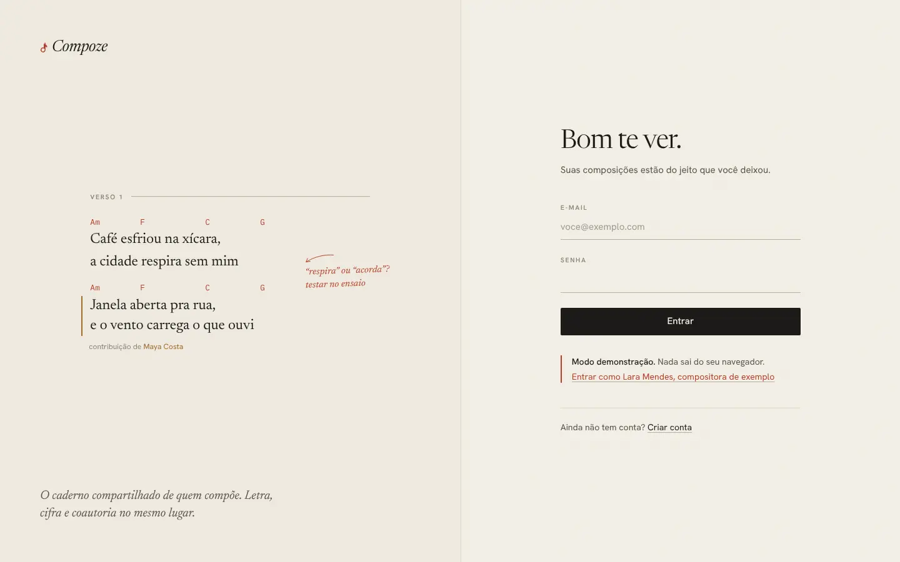
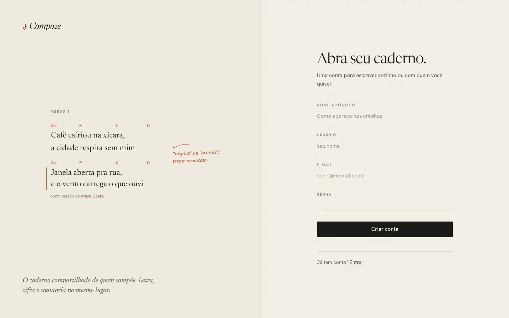

# Entrar e criar conta

`/login` e `/cadastro` · `apps/web/src/pages/auth/` (`Login.tsx`,
`Register.tsx`, `AuthLayout.tsx`)

## Para que serve

É a porta do Compoze. Quem já tem conta entra com e-mail e senha; quem não tem
cria uma com nome artístico, usuário (o `@`), e-mail e senha. São as únicas
telas que não pedem sessão.

## O que dá para fazer

- **Entrar** com e-mail e senha. O botão vira "Entrando…" enquanto espera.
- **Criar conta.** A validação acontece antes de mandar:
  - nome artístico obrigatório ("Como você assina suas canções?");
  - usuário de 3 a 30 caracteres, só minúsculas, números, ponto, hífen ou
    `_` (a mesma regra do contrato da API, porque o usuário entra no endereço
    do perfil). Enquanto a pessoa digita, aparece `compoze.app/@usuario`;
  - e-mail com formato válido;
  - senha de pelo menos 8 caracteres.
- **Ir de uma para a outra** pelo link no rodapé ("Ainda não tem conta?" /
  "Já tem conta?").
- **No modo demonstração**, "Entrar como Lara Mendes, compositora de exemplo"
  abre um caderno pronto, sem servidor.

## Como foi feita

- `AuthLayout` divide a tela em duas folhas. À esquerda (só em telas largas),
  um trecho de canção desenhado como no editor: rótulo de seção, cifra em
  lápis vermelho, versos em serifa, um trecho com o fio de cor de outra
  coautora ("contribuição de Maya Costa") e uma anotação a lápis na margem
  ("'respira' ou 'acorda'? testar no ensaio"). À direita, o formulário.
- O formulário chama `useAuth().login` ou `register` (`store/authStore.ts`),
  que falam com `POST /auth/login` e `POST /auth/register`. A API devolve um
  par de tokens: o de acesso (JWT de 30 minutos) e o de renovação (30 dias,
  de uso único). O app guarda os dois no aparelho e renova sozinho quando o de
  acesso vence ([ADR 0006](../decisoes/0006-autenticacao-propria.md)).
- **Volta para onde a pessoa ia.** Se alguém abriu um link (um convite, uma
  canção, um texto compartilhado) sem estar logado, o guarda de rota
  (`RequireAuth`) manda para o login com o destino em `state.from`. Depois de
  entrar ou criar a conta, a pessoa cai no destino, não na Mesa. Vindo de um
  convite, o subtítulo muda: "Entre para aceitar o convite. Se ainda não tem
  conta, crie uma: leva um minuto."
- **Acorda o servidor.** No plano grátis do Render, a API dorme depois de 15
  minutos sem uso e leva até um minuto para acordar. As duas telas chamam
  `/health` assim que abrem (`lib/acordar.ts`), para a API ir acordando
  enquanto a pessoa digita. Se o envio passar de 4 segundos, aparece a nota
  `AvisoAcordando` explicando que o servidor está acordando.

## Decisões e porquês

| Decisão | Por quê |
| --- | --- |
| Autenticação própria em vez de Better Auth | O contrato de tokens já existia e o uso offline pede exatamente um par curto + longo. Detalhes no [ADR 0006](../decisoes/0006-autenticacao-propria.md) |
| O lado esquerdo mostra o produto, não uma ilustração | "O produto se explica": um trecho de canção como no editor diz o que é o Compoze melhor do que uma foto de banco de imagens ([design system](../frontend/design-system.md)) |
| Validação no aparelho com a mesma regra da API | Erro aparece na hora, sem esperar um servidor que pode estar dormindo |
| Login com e-mail inexistente devolve a mesma mensagem que senha errada | Não revela quais e-mails têm conta (ADR 0006) |
| Sem "esqueci a senha" por e-mail | Ainda não há e-mail transacional ligado. Quem está logado em algum aparelho troca a senha em Ajustes → Senha ([ADR 0019](../decisoes/0019-senha-nova-sem-a-atual.md)). Ver [futuro](../produto/futuro.md) |

## Sem internet

Entrar e criar conta pedem servidor. Quem **já entrou** no aparelho não passa
por aqui: o app abre na hora com a última sessão e a cópia local do caderno, e
confere a sessão em segundo plano ([casca.md](casca.md)).
