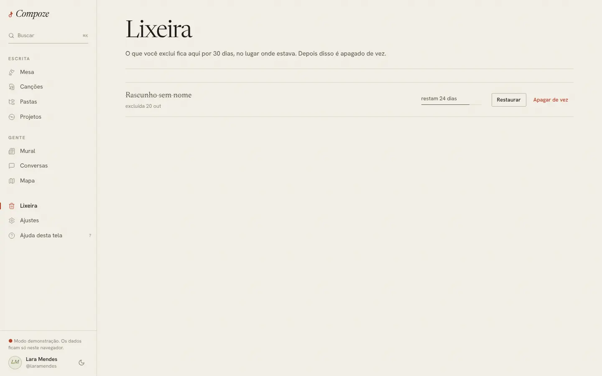

# Lixeira

`/trash` · `apps/web/src/pages/app/Trash.tsx`,
`apps/api/src/modules/lixeira/expurgo.ts`

## Para que serve

Segurar por 30 dias as canções excluídas, para que ninguém perca uma letra por
engano.

## O que dá para fazer

- Ver cada canção excluída, com o título riscado, quando foi excluída e
  **quantos dias restam** (em vermelho a partir de 5; "sai hoje" no último
  dia), com uma barra que esvazia com o tempo. As que saem primeiro vêm no
  topo.
- **Restaurar**: a canção volta para o caderno **no mesmo lugar**, com a pasta
  e os projetos de antes.
- **Apagar de vez**, com a confirmação "Isso não tem volta."

## Como foi feita

- A lista vem do store (`listTrashed`, canções com `deletedAt`). Excluir em
  qualquer tela grava `deleted_at`; restaurar o limpa
  (`POST /songs/{id}/restore`). Apagar de vez é
  `DELETE /songs/{id}/permanent`.
- **Quem apaga de vez, depois dos 30 dias, é o servidor**: um job do pg-boss,
  `expurgo-da-lixeira`, roda todo dia às 3h (horário de Brasília). Ele também
  limpa imagens sem dono e chaves de idempotência com mais de 24 h. No plano
  grátis do Render a API dorme; se estiver dormindo às 3h, o job roda quando
  ela acordar.
- Ao abrir a tela, o app relê a lista para refletir o que o servidor já
  expurgou.

## Decisões e porquês

| Decisão | Por quê |
| --- | --- |
| Exclusão reversível, preservando pasta e projeto (RN07) | Restaurar deve devolver a canção exatamente aonde estava |
| 30 dias (RN08), contados pelo servidor | O prazo tem de valer mesmo que nenhum aparelho abra o app; o cliente só mostra quanto falta |
| Só a dona exclui | Uma coautora não pode tirar a obra de todo mundo |
| Memos de voz não passam pela lixeira | São apagados um a um, com aviso; a lixeira é de canções inteiras |

## Sem internet

A lista abre do aparelho, e restaurar ou apagar entram na fila.
