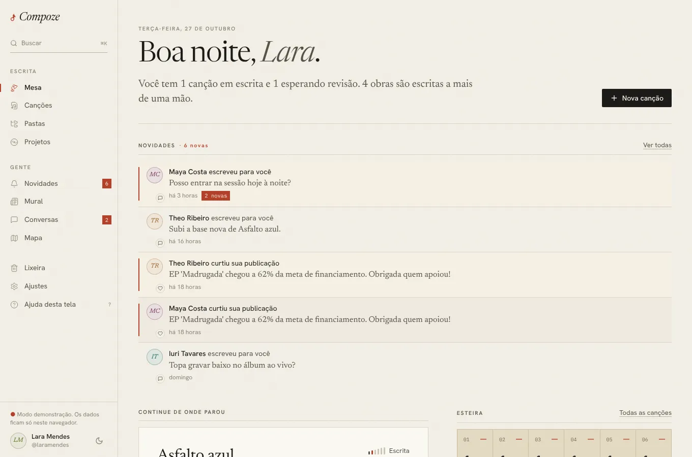

# Mesa

`/` · `apps/web/src/pages/app/Dashboard.tsx`,
`components/compoze/ConvitesRecebidos.tsx`

## Para que serve

É a tela inicial depois de entrar: a mesa de trabalho de quem compõe. Responde
em segundos a "onde eu parei?" e "o que pede atenção?", e leva direto para a
canção em que a pessoa estava.

## O que aparece

1. **Cabeçalho.** A data por extenso, uma saudação com o primeiro nome ("Boa
   tarde, Lara.") e **uma frase de resumo** do caderno, por exemplo: "Você tem
   1 canção em escrita e 1 esperando revisão. A divisão de 'Costa quebrada'
   ainda não fecha 100%." O botão **Nova canção** fica ao lado.
2. **Convites** recebidos pela conta, quando houver: "Theo te chamou para
   escrever 'Rua de cima' · Composição · ontem", com **Aceitar** e
   **Recusar**. Aceitar abre a canção no editor. Some quando não há nenhum.
3. **Continue de onde parou.** A canção editada mais recentemente, como uma
   folha: título, quando foi editada, tom, andamento, estágio, as primeiras
   quatro linhas (cifra em vermelho, versos em serifa), os coautores e "Abrir
   no caderno". Abaixo, as cinco seguintes, uma por linha.
4. **Esteira.** Seis casas numeradas, uma por estágio (Ideia, Escrita,
   Revisão, Finalizada, Registrada, Gravada), com quantas obras há em cada,
   num cartão de **papel kraft** (pardo) para não sumir no papel da página.
   Um traço curto do lápis marca os estágios que têm obra. Cada casa abre
   Canções já filtrada naquele estágio.
5. **Projetos em andamento.** Os três primeiros, com a capa, formato e fase
   ("EP · Produção") e a barra do financiamento.
6. **Na roda.** As três publicações mais novas do mural de quem a pessoa
   segue, num quadro **bege claro** em vez de soltas no branco, separadas por
   réguas.

Caderno vazio: "O caderno está em branco. Toda canção começa com uma linha
só." e o botão "Escrever a primeira".

## Como foi feita

- Canções, projetos e pessoas vêm do store do caderno (`useCompoze`), que já
  está carregado e tem cópia no aparelho: a Mesa abre na hora, com ou sem
  rede. É a única tela que vem no pacote principal do JavaScript; as outras
  carregam sob demanda.
- O resumo é calculado por `resumo()` no próprio componente: conta canções em
  escrita e em revisão, procura uma divisão de coautoria que não soma 100% e,
  se não houver, conta as obras escritas a mais de uma mão.
- "Na roda" usa React Query (`["mural","roda"]`, `GET /feed?limit=3`). O mural
  não tem cópia offline; sem rede, a seção diz "O mural precisa de internet."
- Os convites vêm de `GET /invites` cada vez que a Mesa abre com
  rede, para que um convite que chegou depois apareça ao voltar para cá
  ([ADR 0010](../decisoes/0010-convites.md)).
- **Nova canção** cria "Sem título" com id gerado no aparelho (UUIDv7) e abre
  o editor. Funciona offline: o pedido espera na fila
  ([ADR 0008](../decisoes/0008-fila-offline-sobre-o-rest.md)).

## Decisões e porquês

| Decisão | Por quê |
| --- | --- |
| Uma frase de resumo em vez de quatro cartões de estatística | Uma linha que diz o que pede atenção vale mais do que números soltos. É também o que afasta a tela da cara de painel genérico ([design system](../frontend/design-system.md)) |
| A última canção aparece como folha, com as primeiras linhas | Ver o próprio verso é o jeito mais rápido de lembrar onde parou |
| Esteira em kraft e Na roda em bege (tokens `kraft` e `bege`) | O testador achou a Esteira apagada e o Na roda branco demais; são outros papéis, não novas cores de acento ([ADR 0021](../decisoes/0021-ajustes-do-primeiro-teste.md)) |
| Esteira com as seis etapas sempre visíveis, mesmo zeradas | Mostra o caminho inteiro de uma obra, da ideia à gravação, e convida a mover as que estão paradas |
| Convites no topo da Mesa | Entrar numa canção sempre depende do aceite de quem foi convidado ([ADR 0010](../decisoes/0010-convites.md)); o convite precisa estar onde a pessoa olha primeiro |
| Saudação pelo primeiro nome e pela hora | O app é pessoal, um caderno, não um sistema |

## Sem internet

Abre e funciona: a última canção, a esteira e os projetos vêm do aparelho.
"Na roda" mostra que precisa de internet, e Aceitar/Recusar convite ficam
desligados com a explicação no próprio botão.
