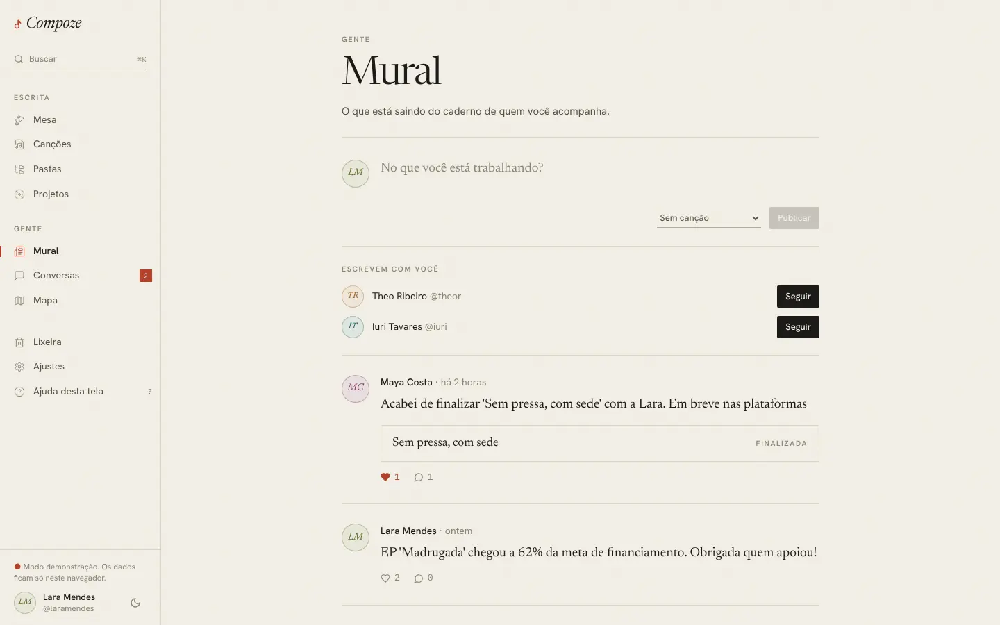

# Mural

`/feed` · `apps/web/src/pages/app/Feed.tsx`,
`components/gente/Publicacao.tsx`, `BotaoDeSeguir.tsx`, `cache.ts`

## Para que serve

"O que está saindo do caderno de quem você acompanha." Um mural curto, de
quem compõe para quem compõe: no que cada um está trabalhando, que canção
acabou de fechar, quem procura parceria. Mostra as publicações da própria
pessoa e de quem ela segue.

## O que dá para fazer

- **Publicar** um texto de até 1.000 caracteres ("No que você está
  trabalhando?"), opcionalmente **citando uma canção** do caderno. Só dá para
  citar canção que não seja privada.
- **Curtir** (muda na hora; se o servidor recusar, volta) e **comentar** (até
  500 caracteres). Quem escreveu o comentário e a autora da publicação podem
  apagá-lo.
- **Apagar** a própria publicação.
- **Seguir** pessoas sugeridas em "Escrevem com você": coautoras que a pessoa
  ainda não segue.
- **Mais antigas**: as publicações vêm em páginas.
- Tocar no nome ou no monograma abre o perfil. A canção citada abre no editor
  **só para quem escreve nela**; os outros veem o título e o estágio.

## Como foi feita

- Tudo pela API, com React Query: `useInfiniteQuery` em `["mural","meu"]`
  (`GET /feed`, paginado por cursor, o id da publicação mais antiga da
  página), sugestões em `["sugestoes"]` (`GET /suggestions/people`).
- O id da publicação é gerado no aparelho (UUIDv7), como em todo o app; a
  publicação nova entra no topo do cache sem reler a página.
- `trocarNoMural` (`components/gente/cache.ts`) muda uma publicação em todas
  as páginas de mural em cache (o meu, o do perfil, "Na roda" da Mesa) de uma
  vez, para curtir num lugar refletir nos outros.
- No servidor: tabelas `follows`, `posts`, `post_likes`, `post_comments`
  (migração 0010). A API confere de novo que a canção citada não é privada.

## Decisões e porquês

| Decisão | Por quê |
| --- | --- |
| Mural de quem a pessoa segue, em ordem de data | Simples de entender e de manter; sem algoritmo decidindo o que aparece ([ADR 0013](../decisoes/0013-seguir-e-mural.md)) |
| Seguir é de mão única, sem pedido | Como numa rede social de criadores: seguir alguém não dá acesso a nada privado, só ao que ela publica |
| Só canção não privada pode ser citada | A citação mostra título e estágio para quem não é coautor; uma canção privada não pode vazar por aí |
| Mural fora do store do caderno, sem cópia offline | É conteúdo dos outros, muda o tempo todo e não é trabalho da pessoa; guardar no aparelho só ocuparia espaço |
| Curtir otimista | Um coração que demora parece quebrado |

## Sem internet

O mural precisa de internet e diz isso no lugar da caixa de publicar e da
lista.
