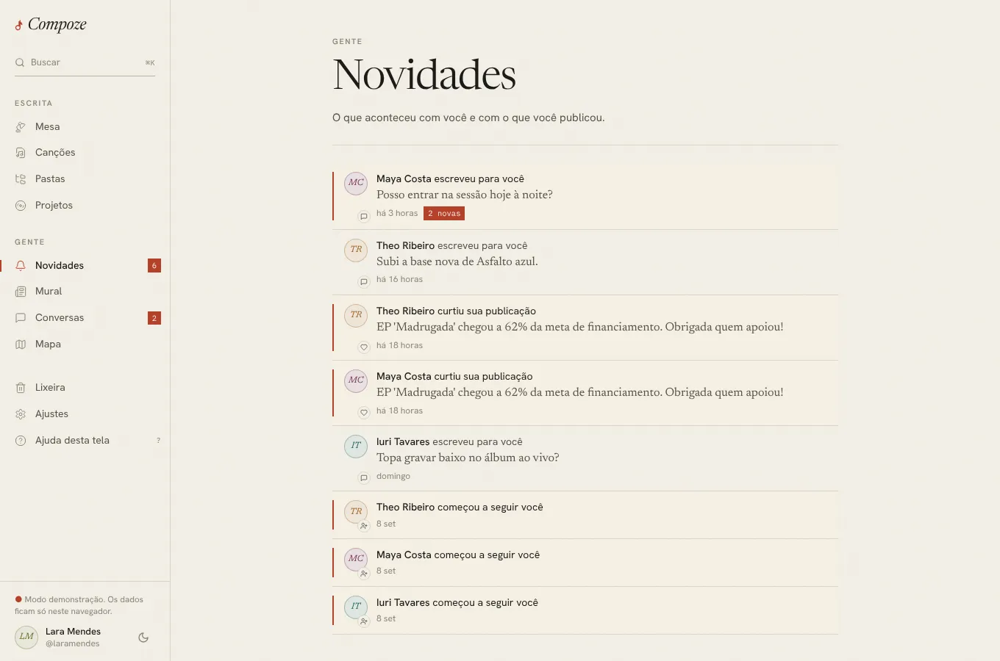
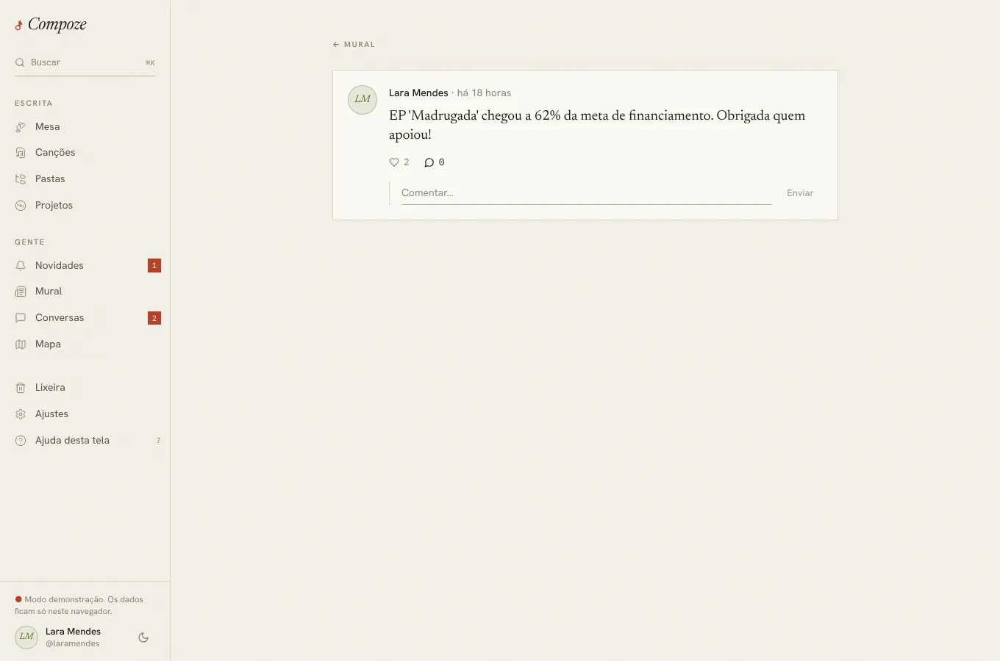

# Novidades

`/novidades` · `apps/web/src/pages/app/Novidades.tsx`,
`components/gente/Novidades.tsx`, `novidades.ts`, `NovidadesNaMesa.tsx`;
publicação sozinha em `/posts/:id` · `pages/app/Post.tsx`

No celular, o sino da barra de cima mostra quantas são novas:

## Para que serve

"O que aconteceu com você e com o que você publicou." É a lista inteira das
novidades que a [Mesa](mesa.md) resume nas cinco mais novas, como a aba de
notificações de uma rede social.

## O que aparece

Uma linha por novidade, da mais nova à mais antiga, com o rosto de quem fez,
um ícone do tipo, a frase, o trecho e quando:

| Tipo | Frase | Abre |
| --- | --- | --- |
| Mensagem | "Maya escreveu para você" + a última mensagem; "2 novas" se houver mais de uma por ler | a conversa |
| Comentário | "Theo comentou sua publicação" + o comentário | a publicação, com os comentários abertos |
| Curtida | "Iuri curtiu sua publicação" + o começo dela | a publicação |
| Seguidor | "Bia começou a seguir você" | o perfil dela |
| Convite | "Theo te chamou para escrever 'Maré'" | a Mesa, onde estão Aceitar e Recusar |
| Convite aceito | "Bia aceitou o convite para 'Maré'" | a canção |
| Apoio | "Ana diz que mandou R$ 40 para 'Disco'. Confira no banco." | o projeto |
| Apoio confirmado | "Lara confirmou seu apoio de R$ 40 a 'Disco'" | a página de apoio |

As novas levam o traço vermelho do lápis à esquerda e um fundo bege. **Ver
mais** traz a página seguinte. A publicação aberta por uma novidade
(`/posts/:id`) é o mesmo cartão do mural, sozinho, com os comentários já
abertos:

## Como foi feita

- `GET /notifications` monta a lista na hora, das tabelas de origem
  ([ADR 0023](../decisoes/0023-novidades-na-mesa.md)): desfazer a curtida ou
  apagar o comentário tira a novidade.
- A Mesa, o contador do menu e o sino usam a mesma consulta (`useNovidades`,
  chave `["novidades"]`), relida a cada minuto e quando chega ou é lida uma
  mensagem pelo fluxo ao vivo (`AoVivo.tsx`). A tela inteira usa uma consulta
  paginada à parte (`["novidades","todas"]`).
- Ao sair da tela (ou da Mesa), `useMarcarVistasAoSair` chama
  `PUT /notifications/seen`. Mensagem continua nova até a conversa ser lida.
- O modo demonstração monta as mesmas novidades a partir das conversas,
  publicações, seguidores e convites de exemplo (sem PIX).

## Decisões e porquês

| Decisão | Por quê |
| --- | --- |
| Sem tabela de notificações | Nada a gravar quando algo acontece, e nada fica para trás quando a ação é desfeita |
| Marcar como visto ao sair, não ao abrir | O destaque fica enquanto a pessoa olha |
| Mensagem nova segue a conversa | Não dá para "ver" uma mensagem pela lista; o número tem de bater com o de Conversas |
| Uma linha por curtida | Simples; agrupar ("e mais 3") pode vir depois |
| Push também para comentário, não para curtida | Comentário pede resposta; curtida seria barulho no celular |

## Sem internet

"As novidades precisam de internet." O sino e o contador mostram o último
número lido.
