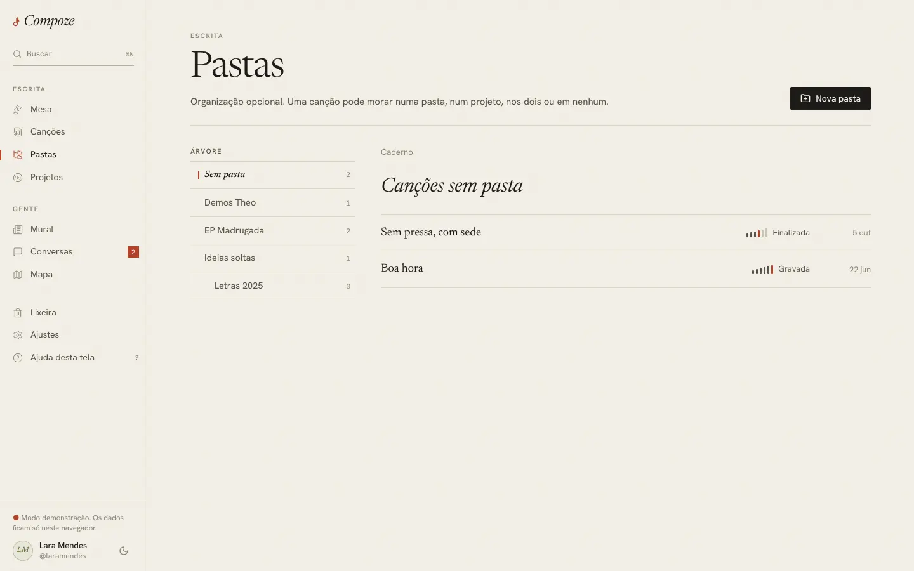

# Pastas

`/folders` (com `?pasta=`) · `apps/web/src/pages/app/Folders.tsx`

## Para que serve

Organizar as canções como a pessoa quiser ("Letras de 2026", "Com o Theo",
"EP Madrugada"), com pastas dentro de pastas. É **opcional**: uma canção pode
morar numa pasta, num projeto, nos dois ou em nenhum.

## O que dá para fazer

- Navegar pela **árvore** à esquerda. A primeira entrada é "Sem pasta", com as
  canções soltas. Cada pasta mostra quantas canções tem.
- Ver o **caminho** ("Caderno › EP Madrugada › Demos") e voltar por ele.
- **Nova pasta** ou, com uma pasta aberta, **Nova subpasta**.
- **Renomear** e **Excluir pasta** pelo menu "Pasta".
- Abrir uma canção da lista.

Para pôr uma canção numa pasta, escolhe-se a pasta na ficha técnica do editor.
A pasta vazia diz exatamente isso: "Escolha a pasta na ficha técnica de uma
canção para trazê-la para cá."

## Como foi feita

- As pastas vêm do store do caderno (`folders`, com `parentId`). A árvore é um
  componente recursivo (`Arvore`) com recuo de 16 px por nível, ordenado em
  ordem alfabética do português.
- A pasta aberta fica no endereço (`?pasta=<id>`), para a busca global (⌘K)
  conseguir abrir uma pasta direto.
- Criar, renomear e excluir chamam `/folders` (`POST`, `PATCH`, `DELETE`) pela
  fila offline.
- O servidor impede ciclos (uma pasta não pode ficar dentro de uma filha dela).

## Decisões e porquês

| Decisão | Por quê |
| --- | --- |
| Pastas opcionais | Muita gente não organiza nada, e tudo bem: "Sem pasta" é um estado válido, não um erro |
| Excluir uma pasta não apaga nada | As subpastas sobem um nível e as canções ficam sem pasta. Perder letra por arrumar o caderno seria imperdoável |
| Pasta escolhida na ficha da canção, não arrastando | Funciona igual no celular e no computador, e a ficha já é onde mora a organização da canção |

## Sem internet

Funciona: criar, renomear e excluir entram na fila e sobem quando a rede
volta.
