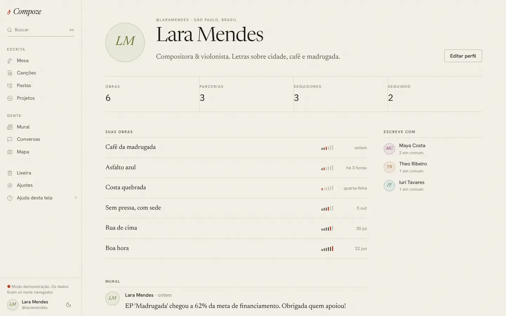
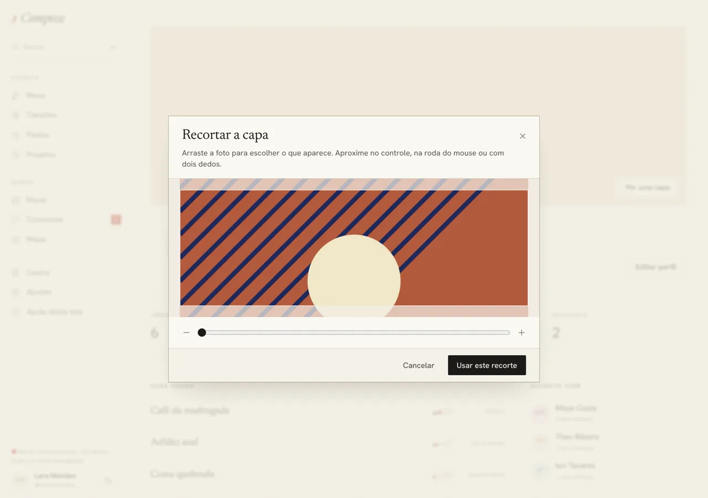
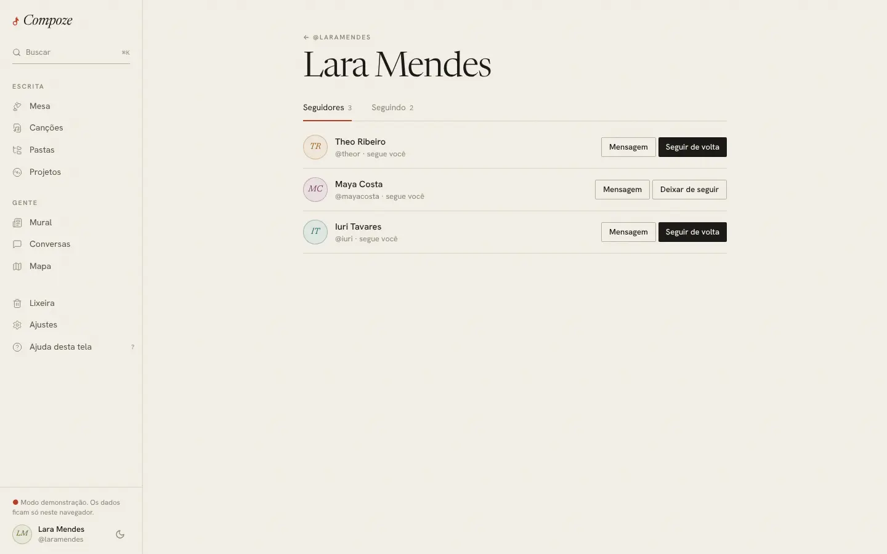

# Perfil, seguidores e seguindo

`/profile`, `/profile/:username`, `/profile/:username/seguidores`,
`/profile/:username/seguindo` · `apps/web/src/pages/app/Profile.tsx`,
`Seguidores.tsx`, `components/gente/BotaoDeSeguir.tsx`

## Para que serve

A página de uma pessoa no Compoze: quem ela é, o que escreve, com quem
escreve e o que publica. O próprio perfil é o mesmo, visto por dentro.

## O que aparece

- **Capa**: uma faixa larga no topo, sempre em 3:1, com a foto de capa da
  pessoa. Sem foto, papel kraft com a pauta de cinco linhas. No próprio
  perfil, **Pôr uma capa** / **Trocar capa** / **Tirar** ficam sobre a capa.
  A foto escolhida abre a **janela de recorte** (arrastar posiciona; o
  controle, a roda ou dois dedos aproximam), sai em 1600×533 px e sobe por
  `PUT /users/me/cover` ([ADR 0021](../decisoes/0021-ajustes-do-primeiro-teste.md),
  [ADR 0022](../decisoes/0022-recorte-de-imagens.md)). Depois da troca, a
  consulta do perfil é invalidada para a capa nova aparecer na hora.

- **Cabeçalho**: monograma ou foto, subindo sobre a capa, `@usuario`, "segue
  você" (se for o caso), cidade e país, nome e bio.
- **Ações**: no próprio perfil, **Editar perfil** (leva a Ajustes). No de outra
  pessoa, **Seguir** (ou "Seguindo", ou "Seguir de volta" quando ela já me
  segue) e **Conversar**.
- **Quatro números**: Obras, Parcerias, **Seguidores** e **Seguindo**. Os dois
  últimos abrem a lista de pessoas (como no Instagram).
- **Obras**: no próprio perfil, todas de que a pessoa participa. No de outra
  pessoa, só as que ela deixou visíveis **e** que eu consigo ver (as obras em
  comum).
- **Mural** da pessoa, com "Mais antigas".
- **Escreve com**: as parcerias, com quantas obras em comum.

## Seguidores e seguindo

Duas abas, com a contagem. Cada linha tem a pessoa (com "segue você" quando
for o caso), **Mensagem** (abre ou cria a conversa a dois) e o botão de
seguir: **Seguir**, **Seguir de volta** ou **Deixar de seguir**. Seguir ou
deixar de seguir muda só o botão; a pessoa continua na lista, para não pular
de lugar embaixo do dedo.

## Como foi feita

- **Duas fontes de dados de propósito.** O que vem do caderno (nome, bio,
  cidade, cor de autor, obras e parcerias) sai do store, que tem cópia no
  aparelho: o perfil de quem já aparece nas minhas obras abre offline.
  Seguidores, "segue você" e o mural vêm da API (`GET /profiles/{username}`,
  `["perfil", username]`) com React Query.
- As listas usam `GET /users/{id}/followers` e `/following`, que trazem para
  cada pessoa `followed_by_me` e `follows_me` (`["lista-de-gente", lado, id]`).
- `BotaoDeSeguir` muda na hora, atualiza o perfil e as listas em cache e relê
  o mural, porque quem eu sigo muda o que aparece nele. Seguir alguém avisa a
  pessoa ([ADR 0016](../decisoes/0016-avisos-por-push.md)).

## Decisões e porquês

| Decisão | Por quê |
| --- | --- |
| Obras de outra pessoa: só as visíveis e em comum | Ver uma canção exige ser coautor. O perfil não pode virar porta dos fundos para obras alheias |
| Monograma em vez de foto genérica | Quem não pôs foto ganha as iniciais em serifa itálica, na cor de autor, e não um boneco cinza ([ADR 0015](../decisoes/0015-imagens-no-postgres.md) para a foto) |
| Números clicáveis, listas com Mensagem | É o jeito que a pessoa já conhece de redes sociais, e "Mensagem" encurta o caminho até a parceria ([ADR 0013](../decisoes/0013-seguir-e-mural.md)) |

## Sem internet

O próprio perfil e o de coautores abrem, com obras e parcerias. Seguidores,
mural e as listas precisam de internet e dizem isso.
