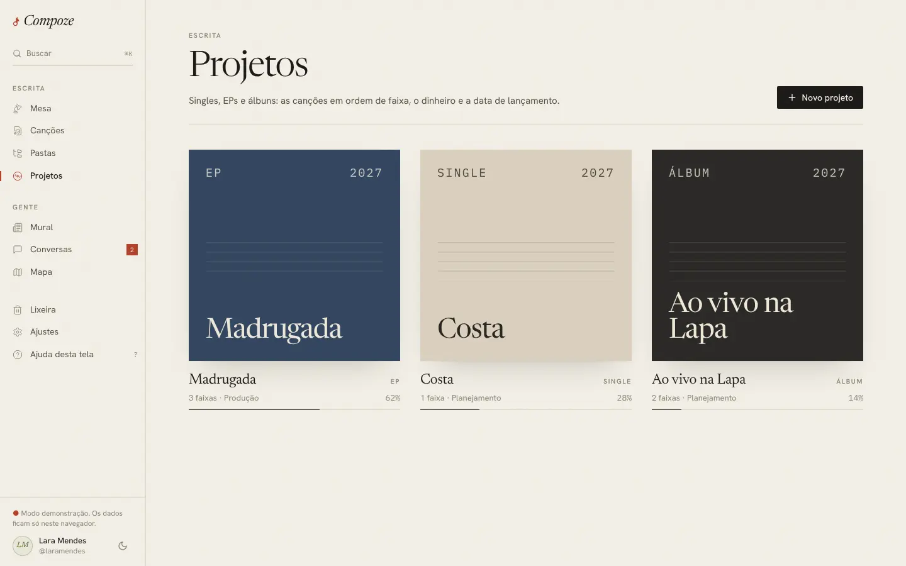
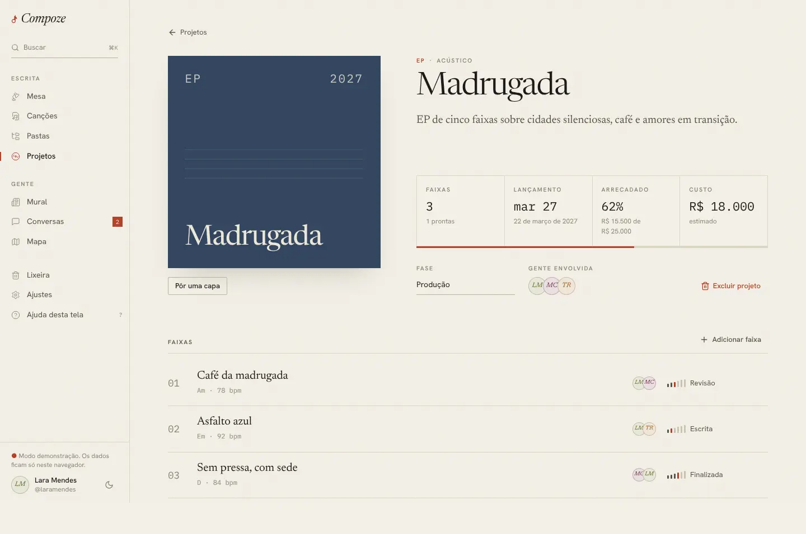

# Projetos

`/projects` e `/projects/:id` · `apps/web/src/pages/app/Projects.tsx`,
`ProjectDetail.tsx`, `components/compoze/NovoProjeto.tsx`, `Capa.tsx`,
`EscolherImagem.tsx`, `ApoioPorPix.tsx`, `LivroCaixa.tsx`, `lib/faixas.ts`

## Para que serve

Reunir canções num **single, EP ou álbum** para planejar o lançamento: a ordem
das faixas, a fase da produção, quanto vai custar, quanto já entrou e quando
sai. É também onde a dona recebe **apoio por PIX** de quem quer ajudar a
lançar.

## A lista

Uma grade de capas, **duas por linha já no celular** (três no computador,
quatro nas telas largas), cada uma com o formato, o nome, quantas faixas, a
fase, o percentual arrecadado com uma barra fina (se houver meta) e **Abrir e
editar**. **Novo projeto** abre um diálogo com:

- nome;
- formato: Single, EP ou Álbum;
- estilo: Acústico, Banda ou Ao vivo;
- sobre ("O que une essas canções?");
- data de lançamento, meta de financiamento e custo estimado, em reais.

### A capa tipográfica

Projeto sem arte própria ganha uma **capa feita de tipografia**: o nome em
serifa grande, o formato e o ano no alto e cinco linhas de pauta, sobre um de
seis papéis tingidos (areia, grafite, tijolo, sálvia, creme, azul). A cor é
escolhida pelo id do projeto, então o mesmo projeto tem sempre a mesma capa.
Tudo é medido em `cqw` (unidade do container), para a mesma composição valer
em 64 px na Mesa e em 380 px no detalhe.

**Por quê:** em vez da foto de banco de imagens que todo app usa, a capa sem
arte já parece um disco de verdade ([ADR 0002](../decisoes/0002-reescrita-do-frontend.md)).

## O detalhe do projeto

- **Capa**, com "Pôr uma capa" / "Trocar capa" e "Voltar à capa tipográfica".
  A imagem é reduzida no aparelho para 1200 px antes de subir
  ([ADR 0015](../decisoes/0015-imagens-no-postgres.md)).
- **Formato · estilo**, nome e descrição.
- Quatro números: **Faixas** (quantas estão prontas, isto é, finalizadas,
  registradas ou gravadas), **Lançamento**, **Arrecadado** (percentual e "R$ X
  de R$ Y") e **Custo**: a soma dos custos lançados ("lançado · estimado R$
  Y") ou, sem nenhum, o estimado. Abaixo, a barra de financiamento em
  vermelho.
- **Fase**: Planejamento, Produção, Mixagem, Lançado.
- **Gente envolvida**: todos os coautores das faixas.
- **Editar projeto** abre o mesmo diálogo da criação, preenchido: nome,
  formato, estilo, sobre, lançamento, meta e custo estimado. Vai pela fila
  offline.
- **Faixas**, numeradas como no verso de um disco: título, tom e andamento,
  coautores, estágio. **Adicionar faixa** lista as canções do caderno que
  ainda não estão no projeto, com o campo **Número da faixa**: vazio segue a
  ordem (depois da maior), ou a pessoa escreve o número, que pode pular (a 7
  num projeto de duas) mas não repetir. Tocar no número de uma faixa vira
  campo: Enter grava, Esc desiste, e se outra faixa já tem o número as duas
  trocam de lugar. O `−` retira uma faixa ("A canção continua no caderno").
- **Excluir**, com a confirmação "As canções não vão junto".

### Entradas e custos (só a dona vê)

O livro-caixa do projeto ([ADR 0021](../decisoes/0021-ajustes-do-primeiro-teste.md)):

- Um resumo em três números: **Entrou** (o arrecadado, "de R$ meta"),
  **Custos** (a soma, "estimado R$ Y") e **Saldo** (em vermelho, "falta
  cobrir", quando os custos passam do que entrou).
- **Entradas**: cada uma com descrição, categoria e data, e "Lançar entrada"
  (ex.: show no Bar do Zé, R$ 500). A entrada soma no arrecadado. O que o
  arrecadado tem além delas aparece numa linha só, **Apoios recebidos**
  (os apoios por PIX confirmados).
- **Custos de produção**: cachês, estúdio, locação de espaço, mixagem…, item a
  item, com "Lançar custo".
- Categoria é texto livre com sugestões (Show, Venda, Edital, Dinheiro
  próprio, Apoio; Cachê, Estúdio, Locação de espaço, Mixagem, Masterização,
  Divulgação, Transporte). Tocar num lançamento corrige; a lixeira apaga, e a
  soma do arrecadado acompanha.

### Apoio por PIX (só a dona vê)

Na primeira vez, um formulário pede a **chave PIX** (aleatória, e-mail,
celular, CPF ou CNPJ, conferida pelo tipo), o **nome de quem recebe** (até 25
letras, como o banco mostra) e a **cidade** (até 15), e se está "Aceitando
apoio agora". O texto recomenda a chave aleatória ou o e-mail em vez do CPF,
porque quem paga vê a chave.

Depois disso:

- "Recebendo apoio na chave … em nome de …. O dinheiro vai direto para essa
  conta; o Compoze só anota o que você confirmar."
- **Copiar link de apoio** (`/apoiar/<id>`), para divulgar onde quiser.
- **Para conferir no extrato**: quem disse que pagou, quanto, o identificador
  da transação e quando, com **Chegou** e **Não chegou**. Só o que chegou soma
  no arrecadado, e quem apoiou é avisado.
- **Já conferidos**, com os recusados riscados.
- **Trocar chave** e **Parar de receber**.

A outra ponta, de quem apoia, está em [apoiar.md](apoiar.md). Decisão
completa, incluindo por que não há Mercado Pago por enquanto, no
[ADR 0018](../decisoes/0018-apoio-por-pix.md).

## Como foi feita

- Projetos vêm do store do caderno, já com as faixas (`GET /projects` traz
  `songs`). O detalhe relê o projeto ao abrir (`loadProject`).
- Mudar fase, editar o projeto, adicionar, renumerar e retirar faixa, criar e
  excluir passam pela fila offline. A troca de números é feita no aparelho
  com o mesmo algoritmo do servidor (`lib/faixas.ts`), e o projeto guarda
  `trackNumbers`. Capa, PIX e entradas e custos pedem rede (imagem e dinheiro
  não entram na fila).
- Entradas e custos usam React Query (`["lancamentos", id]`,
  `GET /projects/{id}/entries`); lançar, corrigir ou apagar relê o projeto
  para o arrecadado mudar. A entrada nasce com id UUIDv7 do aparelho, então
  um reenvio não lança duas vezes.
- O PIX usa React Query (`["pix", id]`, `["apoios", id]`); confirmar um apoio
  relê o projeto para o arrecadado mudar.

## Decisões e porquês

| Decisão | Por quê |
| --- | --- |
| Projeto não é dono das canções | Excluir um projeto não exclui as faixas, e retirar uma faixa não a apaga. Uma canção pode estar em mais de um projeto (o single e depois o álbum) |
| Faixas prontas contam a partir de "Finalizada" | É o que dá para gravar; "Escrita" e "Revisão" ainda vão mudar |
| PIX direto na chave da dona, conferido à mão | Não precisa de conta em gateway, nem de cartão, nem de CNPJ, e não tem taxa. O preço é a dona conferir o extrato ([ADR 0018](../decisoes/0018-apoio-por-pix.md)) |
| Número de faixa à mão, sem repetir; renumerar troca | O testador queria cadastrar a faixa 7 direto. Trocar é o gesto de reordenar e nunca deixa duas "faixa 3" ([ADR 0021](../decisoes/0021-ajustes-do-primeiro-teste.md)) |
| Entrada soma no mesmo arrecadado do PIX | Um número só para "quanto já entrou", seja PIX ou show; custo não mexe nele e fica contra o estimado |
| Na demonstração não há PIX | Não há servidor para guardar a chave nem os apoios |

## Sem internet

Lista e detalhe abrem; mudar fase, editar o projeto e mexer nas faixas entra
na fila. Capa, apoio por PIX e entradas e custos pedem rede ("Entradas e
custos precisam de internet.").
